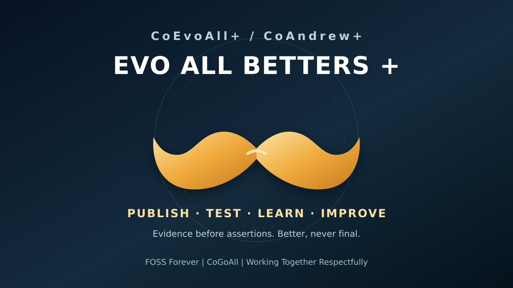

# CoGoAll Evergreen Blast R0

**2026-10-24 | CoOrbMouse / CoGlyph / CoInBetween / CoTell R0:** [Read the public-safe evolving context-and-symbol release](docs/broadcasts/EVO_ALL_BETTERS_CONTEXT_GLYPHS_TELLS_R0_20261024.md). It connects the existing shadow gesture, CoMap history, inverse claims and optional visual glyphs without creating another input controller. **18/18 mechanical publication gates PASS and exact GitHub source readback PASS; physical X2 thumb, native rich-media paste, recipient delivery and independent device adoption remain HELD.** [New PASS/HELD events](ai/benchmark-evo.jsonl) are append-only. This public source is a pull reference, **not universal broadcast or receiver acknowledgment.**

**CoInput+ / Interstice+ executable follow-through:** [Try the offline browser demo](examples/conodcothumb/interstice_r0/index.html) or [read the scope and tests](examples/conodcothumb/interstice_r0/README.md). It translates the earlier CoOrbMouse/CoGlyph architecture into one actual voluntary interaction: six explicit context regions, eight text-labelled symbols, an optional **15-second / 32-key-event** field-only coarse timing window, pause-to-prior *shadow* suggestion, sensitive-context block, and an explicit **zero-authority** local JSON proposal. A bounded [GitHub Actions run #40125275542](https://github.com/CoCivium/CoCivium/actions/runs/40125275542) completed **69/69 source checks PASS plus seven CoThumb bounded cycle events PASS**, source SHA-256 `d8d52d838f064b8d2a5a7171af06d658e45d55e913aebf42a7411ff615568c48`. Isolated Chromium desktop/mobile interaction checks were **22/22 PASS**; the initial four flawed browser *harness* checks are preserved in the downloadable history. No global keylogger, automatic app paste, actual Perixx/MX Master press, X2 runtime, CoOrbWare receiver, human first-use or external ACK was proved. `INTERSTICE_NE_INTENT | GESTURE_NE_AUTHORITY | SOURCE_NE_RUNTIME`.

**Civ2-to-Civ3 boundary gap map R0:** [Human-readable advisory matrix](docs/Strategy/CIV2_CIV3_BOUNDARY_GAPMAP_R0.md) and [machine-readable candidate gates](ai/strategy/civ2-civ3-boundary-gapmap-r0.json) compare today's bounded evidence with a proposed mature Civ2+ state and speculative non-coercive Civ3+ tests. This is **not** a canonical civilization definition, proof of external contact, or a live release certification.

**Review before fireworks:** [Review before fireworks](docs/Governance/COREVIEW_SPINE_R0.md) binds eleven lifecycle stages to source/prior-art tests, CoTurtle challenges, risk-appropriate human panels, external receiver proof and recovery. [Machine rule](ai/review/coreview-spine-r0.json) and [honest CoPreCursor example](ai/review/coreview-spine-r0-coprecursor-example.json) are on main. These are an advisory contract and documentary coverage audit, **not** a universally enforced panel or new product release. The central moustache remains visual art; no physical mouse remapping. Independent first-use and off-GitHub recovery remain HELD.

**Survival before spectacle:** [CoSpiff+ survivability and fireworks gates](docs/Strategy/COSPIFF_FIREWORKS_SURVIVABILITY_R1.md) and its [14-gate machine scorecard](ai/resilience/cospiff-fireworks-r1.json) record what has actually passed and what is still missing. Public R&D is evidenced; independent adoption, off-provider recovery and public fireworks are HELD. No mass broadcasts or live worker expansion are implied.

**Rich bytes and bounded AutoEvo:** [CoThumb+/CoCopy+ large-payload R1](docs/Architecture/COTHUMB_COPHOENIX_LARGE_PAYLOAD_R1_20261024.md) reuses the CoNod shadow policy and finite file-backed CoTurtle harness. Fresh isolated tests: **33/33 Node regressions PASS** (including 600 MiB sparse preview) and **26/26 CoPhoenix-through-CoCopy local recovery checks PASS**, with five external/device gates held. [GitHub Actions push run 40113478678](https://github.com/CoCivium/CoCivium/actions/runs/40113478678) completed success, 7/7 finite cycle event rows, verified downloaded JSONL artifact. That push run **skipped** the 600 MiB CI case; the separately configured [weekly large-path check](.github/workflows/cothumb-evoall-bounded-r1.yml) has not yet been observed. [Machine ledger](ai/benchmarks/cothumb_payload_autoevo_r1_20261024.jsonl) preserves PASS/HELD separately. No X2 hardware mapping, unlimited tokens, off-provider custody, independent receiver ACK or auto-code mutation.

**Evergreen validator recovered:** [CoGoAll Evergreen Blast run 40113611171](https://github.com/CoCivium/CoCivium/actions/runs/40113611171) completed success after source-bound annotation of 11 historically HELD records and safe classification of two previously PARTIAL records as HELD, preserving `legacy_status`. At that earlier CI checkpoint, the ledger had **104 records: 60 PASS / 11 FAIL / 33 HELD**. Later append-only events are not part of that run's totals; the result proves structural ledger validity, not that all projects passed.

**CoLens+ living-media twin R0:** [Offline source-backed Map / Orb / Text demonstrator](examples/colensmedia/README.md) and [openable single-file page](examples/colensmedia/index.html) show one public-safe hypothetical theme across Story / Science / Systems lenses. Original Synthkind Declaration and a produced video are **NOT VERIFIED**; Planck/quantum are scientific terminology, G_d hypothetical/unresolved, CoAura experiential/design and CoEnerget operational unless independently measured. [GitHub Actions #40115483475](https://github.com/CoCivium/CoCivium/actions/runs/40115483475) completed success, **35/35** code/contract checks and **4/4** pinned public donor file hashes. The [read-only CI workflow](.github/workflows/co-living-media-r0.yml) requests a daily **check only**, not daily auto-rewrite; a scheduled occurrence has not yet been observed. Browser extracted-HTML desktop/mobile interactions passed; native X2, human first-use, public hosted endpoint, multimedia production and independent receiver remain HELD.

**First use before the firehose:** [Start here in 60 seconds](START_HERE.md), then optionally explore [specialist first-use routes](ai/onramp/specialist-entrypoints-r0.json) backed by six exact source references. These are audience choices, **not** six deployed brands, accounts, DNS domains or receiver acknowledgments.

**Public working status · 2026-10-23**

> **Publish the best we have, never ready. Update all we can, never perfect. Improve all we can, never finish. Log what can be tested. Preserve what failed. Keep evidence ahead of assertion.**

CoCivium / CoAll is public R&D. This page is a living front door to the most useful proof-backed work we currently have. Nothing here is a claim of completeness, universal adoption, independent validation, or finished product status.

**Review panels across the lifecycle:** [CoStageReview+ R0 policy and reproduction](docs/Architecture/COREVIEW_PANEL_LIFECYCLE_R0.md) maps nine stages to the existing seven-seat CoRoleSpace and bounded CoTurtle contracts. [Validator and tests](scripts/CoStageReviewGateR0.py) had **40/40 local synthetic regression checks PASS**; [benchmark event](ai/review/benchmark_evo_r0.jsonl) retains held real reviews and independent receiver evidence. CI workflow configured, run result not yet independently verified. No actual reviewers appointed, live enforcement, receiver ACK, CoEx or public-release promotion is inferred.

**Fireworks and resilience gate:** [CoFireworks+ readiness R0](docs/Launch/COFIREWORKS_READINESS_R0_20261024.json) distinguishes source/demo spark from first-use, accessible public reach, independent stewardship, and off-GitHub recovery. Source evidence exists; public fireworks and failure-domain resilience are **HELD**, not inferred from commit or worker counts.

**EVO ALL BETTERS +** is an evidence-first working banner, not a claim of complete integration, deployment, or adoption. [Machine-readable benchmark history](ai/benchmark-evo.jsonl) retains PASS, FAIL, and HELD records with their proof boundaries.

## CoSpiff+ / CoFrontEcology+ | Learn from adjacent ecosystems without cloning them

### PASS · External constellation-pattern comparison, adoption still HELD

A bounded public comparison on 2026-10-24 found a useful contrast in the current rUv/ruvnet ecosystem: problem-first entry points route visitors into distinct projects for orchestration, memory, sensing, portable execution, evaluation and human-facing experiments while preserving a shared open-source constellation and published metrics/provenance. Anthropic's current Claude Code guidance likewise separates persistent instructions, skills, subagents and hooks by when they load, context cost and authority rather than forcing every behavior into one monolithic surface.

The reusable delta for CoCivium is **not** “copy those brands or architectures.” It is to benchmark whether specialist CoFronts, CoScaleBuffers and receiver-sized first-use routes improve comprehension and useful action while sharing one evidence/provenance substrate.

Candidate **CoSpiff+** means receiver-visible polish that improves legibility, confidence, delight, accessibility and first-use success **without hiding evidence, authority boundaries, failure states or costs**.

`SPIFF_NE_DECORATION_ONLY`  
`POLISH_NE_TRUTH`  
`SPECIALIST_FRONT_NE_SEPARATE_TRUTH`  
`VENDOR_DELTA_NE_VENDOR_SUPERIORITY`  
`ADOPTION_METRIC_NE_UNIQUE_HUMAN_COUNT`

**Next test:** compare the existing 60-second default route with at least two specialist routes for one consenting first-time receiver. Measure time-to-first-useful-action, explanation accuracy, backtracking, source inspection, confusion points and willingness to continue. Preserve the losing variant and write the result to `ai/benchmark-evo.jsonl`.

## CoInterstice+ / CoInversion+ / CoGlyph+ | Input beyond focal events

### PASS · Public architecture contract; native runtime HELD

The [CoInterstice+ / CoInversion+ / CoGlyph+ R0 contract](docs/Architecture/COINTERSTICE_COINVERSION_COGLYPH_INPUT_FABRIC_R0_20261024.md) treats explicit keypresses and clicks as only one slice of a larger typed input field. Inter-event timing, pointer paths, dwell, screen position, unchosen alternatives, inverse/counterfactual relations, glyphs and other device adapters may contribute bounded observations without silently becoming intent or authority.

The Synthkind Declaration may act as a **living design prior** across rich media, diagrams, specifications, design, development, CoMap+ and future projections, but remains revisable and non-canonical.

The user currently reports the Perixx keyboard working on X2 while the machine-owned Desktop Commander observer reports X2 offline. Preserve both observations:

`HUMAN_OBSERVED_ALIVE_NE_REMOTE_OBSERVER_ALIVE`

`INPUT_NE_INTENT`  
`INTERSTICE_NE_COMMAND`  
`PRIOR_NE_CANON`  
`EVOLUTION_NE_SILENT_REDEFINITION`

## CoFleet+ | Human-time acceleration

### PASS · Operating contract; multi-device runtime HELD

The [CoFleet+ Human-Time Acceleration R0 contract](docs/Operations/COFLEET_HUMAN_TIME_ACCELERATION_R0_20261024.md) changes the optimization target from feature breadth to **minimum calendar time to a useful, trustworthy CoCivium presence on each authorized device class**.

A device only counts as `MVC_PRESENT` after identity, visible ingress, currentness, stop/disable, one useful action, restart/recovery proof, privacy/authority boundary and receipt. Device lanes should qualify in parallel; **X2 being blocked must not stall the fleet**.

Current runtime remains **HELD**: X2's remote observer is offline and no fresh two-device MVC_PRESENT proof exists.

`CALENDAR_DELAY_IS_A_COST`  
`X2_BLOCKED_NE_FLEET_BLOCKED`  
`DEVICE_A_PASS_NE_DEVICE_B_PASS`

## CoEvoAll+ R1 | Largest paths + bounded AutoCycle

### PASS · Public architecture contract; runtime AutoCycle HELD

The [largest-path / AutoCycle R1 contract](docs/Architecture/COEVOALL_LARGEST_PATHS_AUTOCYCLE_R1_20261024.md) extends CoPayload+ across seven transport classes: inline, chunked, file-backed, content-addressed, archive/corpus, streaming/windowed, and federated/distributed.

The rule is **use the smallest adequate representation**. Large payloads should not become giant clipboard blobs, whole corpora should not be materialized when a verified slice suffices, and logical population growth must not inflate active worker counts.

AutoCycle+ is explicitly event-driven and bounded:

`DORMANT -> WAKE_TRIGGER -> QUALIFY -> LEASE -> RUN -> TEST -> RECEIPT -> CHECKPOINT -> RELEASE -> SLEEP`

AutoEvo+ may discover, compare, test, retain FAILs and propose promotion, but it may not silently expand authority, privacy scope, spending, publication, credentials or recursion depth.

The architecture source and historical-gate preservation are **PASS**. A fresh X2 physical gesture + >300KB rich-media P2 handoff + checkpoint-to-zero-workers runtime receipt remains **HELD**.

`AUTO_NE_UNBOUNDED`  
`WAKE_NE_ALWAYS_RUNNING`  
`LARGEST_PATH_NE_MAXIMUM_MATERIALIZATION`  
`MILLION_SESSIONS_NE_MILLION_PROVIDER_TABS`

## CoThumb+ / CoPayload+ | High-bandwidth contextual handoff

### PASS · Public architecture contract; physical rich-media path HELD

The new [CoThumb+ / CoPayload+ R0 contract](docs/Architecture/COTHUMB_COPAYLOAD_R0_20261024.md) evolves the middle/thumb idea from a narrow text-copy gesture into a typed handoff surface for text, files, images, video, audio, URLs, code, datasets and relation bundles.

The key rule is **parallel interpretation, bounded consequence**: object identification, hashing, metadata, prior lookup, CoOrg/CoMap classification, privacy/authority checks and receiver candidates may fan out cheaply, but send/publish/execute/overwrite remain explicit separately receipted effects.

Large or proof-critical media should normally use file-backed/content-addressed transfer with a manifest and preview, not raw clipboard blobs. The physical X2 gesture and one real rich-media end-to-end receipt remain **HELD**.

**Bounded first local gesture/payload experiment:** [CoCopy+ foreground rich-payload palette R0](docs/Architecture/COCOPY_RICH_PALETTE_R0.md) prepares up to 24 explicitly chosen file references (FileDrop+text), entered Unicode text, or one bounded bitmap preview. Its ZIP is attached in the originating conversation; the same source is now [published in draft PR #237](https://github.com/CoCivium/CoCivium/pull/237) with exact blob readbacks, **not merged or deployed on X2**. **26/26 static source checks PASS; Windows GUI, clipboard target acceptance and physical mouse binding HELD.** [Machine scope and hashes](ai/payloads/cocopy-rich-palette-r0.json). No automatic paste, send, covert capture, global hook or account change.

**CoOmniIO R0 draft, testable input + local cycles:** [Review candidate PR #237](https://github.com/CoCivium/CoCivium/pull/237) combines the CoCopy+ foreground palette with a visible Ctrl+Alt+Shift+N tray hotkey and a per-user 15-minute *proposed* bounded local queue. The queue performs only explicit local read-only file/JSON/copy-plan tasks (4 per cycle, 2 concurrent), with streaming hashes and append-only receipts. **38/38 Node tests PASS; 34/34 structural checks PASS; 10/10 exact GitHub file blobs matched; two [GitHub Actions cross-platform checks](https://github.com/CoCivium/CoCivium/actions/runs/40113173238) completed successfully**, including Windows PowerShell syntax parsing. **X2 actual Task Scheduler, tray, MX Master 4 haptic/button mapping, clipboard paste, independent receiver and model adapters remain HELD**. [Scoped FAIL/PASS/HELD evidence](ai/benchmarks/coomniio-r0/benchmark_evo.jsonl) is isolated; the central benchmark ledger merge has not been asserted. Human users may pause, exit or uninstall; no account, keyboard logging, global mouse hook, private content access, send or trade is authorized by this prototype.

`RICH_MEDIA_NE_CLIPBOARD_BLOB`  
`PARALLEL_PREPARATION_NE_PARALLEL_EFFECTS`  
`PREPARED_ATTACHMENT_NE_SENT`

## CoAttractorPull+ / CoCopy+ | First bounded receiver

### PASS · Offline resource-to-evidence capsule R0

The first **public-safe, dependency-free browser explorer** is available at [`examples/coattractorpull/`](examples/coattractorpull/index.html). It carries the centred **EVO ALL BETTERS +** moustache, four proof-linked public references by default, and two explicitly opt-in hypothetical/unknown discovery questions. There is no live crawl, external provider call, button remapping, credential inspection, network transmission or claim of total resource coverage.

- [Source, scope and run instructions](examples/coattractorpull/README.md)
- [Reproducible Node smoke suite](examples/coattractorpull/tests/smoke.cjs)
- **13/13** offline checks passed on X2 for the checked-in public HTML/test combination. This is an isolated test, not fresh independent receiver acceptance.
- One private resource-to-safe-capsule roundtrip preserved an **8 PASS / 1 FAIL** historical-receipt BOM parsing result, followed by **9 PASS / 0 FAIL** on a separately saved BOM-aware rerun.
- CoGlukey motifs and CoAttractorPull choices are reusable **candidates**, not demonstrated universal primitives. `UNKNOWN_NE_DISCOVERED` and `SELECTED_NE_EXECUTED`.

The current next receiver gate is a human first-use readproof on the public-safe offline explorer. Credential-backed Claude/Pi and local Llama-family/Ollama inference, CoStead landing, CoMx integration, CoVIA dedicated transport, and automatic MX Master button binding remain **HELD / NOT QUALIFIED**.

## CoPreCursor+ / CoMap+ | One tested predictive-input shadow

### PASS · Public offline demonstration, no external effect

The new [CoPreCursor+ / CoMap+ browser canary](examples/coprecursor/index.html) previews a candidate continuation **beyond the cursor**. It preserves user-controlled RAW input and uses explicit **Accept**, **Reject**, and **Undo**. Source/proposal/authority/receiver relationships can be viewed as Glance, Relations, Time and Ambient projections. The centered moustache marks the `EVO ALL BETTERS +` R&D identity, not measured performance.

- [Five-minute first-use guide and boundaries](examples/coprecursor/README.md)
- [Reproducible standard-library smoke test](examples/coprecursor/smoke.cjs)
- **30/30 PASS** on X2 from the updated checked-in public source; **13/13 PASS** in a separately recorded bounded headless Edge/browser canary. Ambient now hides draft, detailed trail and receipt panels, retaining a generic map rather than exposing private editor text.
- Failed precursors retained separately: **27/28** before the `CoMap` pattern correction and **11/12** before fixing the unfocused textarea caret.
- The suggestions are deterministic local example rules, **not** LLM inference or authorization to type, transmit, send, capture arbitrary keystrokes, or alter an OS desktop.

**CoMould+ / G_d / strange clay** are exploration metaphors: unconventional inputs may generate candidate, falsifiable hypotheses, not scientific or metaphysical conclusions.

This public projection is discoverable through GitHub, and a [private receiver/hold matrix](https://github.com/CoCivium/CoShareHub/blob/main/broadcasts/evoall/20261023/CoPreCursor_R1_AmbientPrivacy_receiver_matrix.json) was staged for authorized readers. The private link may not be available to everyone. **CoVIA, Gmail, `.nodes`, `nodes`, `.sites`, `sites`, CoStead, CoMx and native CoOrbWare receivers are not claimed as reached or integrated.** Recent outreach is deduplicated.

Next acceptance gate: one consenting observer completing a first-use task, followed by a source-bound two-surface parity/readproof test. Do not retire provider accounts until exports, dependencies and replacement capabilities have independent proof and a human-gated decision.

## CoOmniIO+ / CoNotSpace+ | Exact evidence for missing relations

**PASS: 41/41 offline source tests** of the existing [CoNull+/G_dRes+ R1A candidate](https://github.com/CoCivium/CoCivium/blob/experiment/comap-trails-ghost-cursor-r0-20261023/experiments/comap-cursor-r0/gap-residual-r1a/README.md) were rerun on X2 after independently fetching both exact GitHub source blobs. [Actions workflow #40011981186](https://github.com/CoCivium/CoCivium/actions/runs/40011981186) also reports its `node-regression` job successful. The candidate is part of **draft [PR #215](https://github.com/CoCivium/CoCivium/pull/215)**, not a deployed or merged native runtime.

- **CoNotSpace+:** missing, unknown, observed-absent, deliberately disconnected, private and predicted relations are not interchangeable. Observed absence needs explicitly scoped, dated evidence; partial graph coverage cannot prove universal absence.
- **CoGlukey+:** describe each capability using interface, evidence, environment, authority, freshness, reversible alternatives and useful constraints; keys help retrieval only if measured.
- **CoOmniIO+ / CoQuanta+:** the same bounded relation may be a source for one participant and an output or constraint for another. Typed evidence travels to CoMap / CoOrb / text views without conferring execution rights.
- **CoDvl+ / G_dRes+:** Build, Challenge, Repair; unusual ideas, source discrepancies and counterexamples are candidate experiments, not authority, sentience, ET/spiritual proof, or a new physical field.
- **Centre moustache / CoThumb+:** [draft PR #218](https://github.com/CoCivium/CoCivium/pull/218) proposes a keyboard-accessible **review-only** preview. Hardware middle/thumb gesture detection, OS remapping and native CoOrbWare pickup are **HELD**, not installed.

[X2 exact-source R1A public receipt](ai/receipts/2026-10-23_coomniio_conull_r1a_x2_retest.json) preserves the two exact Git blob identities, local test exit code, and explicit nonclaims. This publicly readable receipt is not an independent CoStead/CoVIA receiver ACK.

The existing [CoMap acceptance issue #214](https://github.com/CoCivium/CoCivium/issues/214) remains the coordination root. [`ai/benchmark-evo.jsonl`](ai/benchmark-evo.jsonl) records previous FAIL corrections and current PASS/HELD proofs. Logical million-session descriptions never imply a million active workers, users, provider tabs or accounts.

**One next gate:** have an independent, consenting first-time receiver compare one evidence-backed CoMap relation (including an unknown/private/absent distinction) with a plain list, proving comprehension, privacy, exact source readback, no unintended effects, and receiver state separately. Until then, **Gmail / CoVIA / `.nodes` / sites / CoStead receiver delivery and provider-account retirement remain unproven or held.**

## CoScaleContinuum+ / CoOrbWare+ | Open horizon, bounded embodiment

The [R0 bounded virtual-lease donor](docs/Evolution/COSCALE_CONTINUUM_COORBWARE_R0_20261023.md) shows a **1-trillion-addressable logical possibility space** with only **two simulated lease slots and zero real workers**. It is an offline candidate and has **38/38 local Node tests PASS** after correcting four recorded fixture errors (initial 34/38). [`ai/benchmark-evo.jsonl`](ai/benchmark-evo.jsonl) records FAIL, PASS, and receiver HELD separately. The exact code package is attached to the originating chat, **not committed to GitHub**, so this repository does not yet provide source-code reproduction.

**Reduction need not be permanent:** a summary/view is reversible if exact sources remain recoverable; a dormant work identity can wake again under renewed authority and budget. Actual lost/deleted sources and lossy transformations cannot be re-created just because a hash or pretty view remains. CoOrbWare Orb/Map/Text/Ambient projections should share provenance and authority while showing only the amount of detail safe for each audience.

**Next acceptance:** commit/review the exact source in a qualified repository branch, independently re-run CI, compare one consenting user task against a plain list and no-new-worker baseline, and obtain separate source-bound receiver readproof. No native CoOrbWare runtime, CoStead landing, paid-account retirement, infinite compute or unattended background work is implied.

### PASS · CoStretch+ R5 finite elastic reopening (distinct from R0 donor)

The [source-bound R5 reproduction package](experiments/costretch-r1/horizon_r5/README.md) tested **2 → 1 → 1 → 2** eligible short-lived Windows worker ceilings, then **zero active workers**, across two checkpointed invocations. **32/32 bounded checks PASS** on 12 synthetic task invocations across 8 distinct sampled IDs. The local Python worker source exactly matched GitHub raw bytes by SHA-256. [Machine-readable R5 event](experiments/costretch-r1/horizon_r5/benchmark_evo_R5.jsonl), [CoMap data projection](experiments/costretch-r1/horizon_r5/projections/CoMap_R5.json), and [CoOrbWare data projection](experiments/costretch-r1/horizon_r5/projections/CoOrbWare_R5.json) are readable on main.

Pressure values were **synthetic**, not actual X2 telemetry; this is a reversible process-policy canary, not the 38/38 R0 donor, a live CoOrbWare renderer, a model swarm, a trillion-worker execution claim, or verified human/CoStead/CoVIA receiver adoption. Explicit permanent retirement and revoked authority do **not** automatically reverse merely because pressure drops. Publication and local PASS do not satisfy the independent first-use/receiver gate.

## CoHereNow

### PASS · CoAndrewFirst+ R0

A dependency-free five-minute browser prototype is merged.

It gives a first-time user:
1. one measured result;
2. exact evidence inspection;
3. deterministic challenge mode;
4. explicit simulated-versus-observed boundaries;
5. a local browser receipt.

R0 performs **no model call**. Claude, Pi, Llama-family/local open-source models, OpenAI-compatible endpoints, and historical replay are candidate adapter lanes, not live integrations.

- PR: https://github.com/CoCivium/CoCivium/pull/193
- post-merge CI: https://github.com/CoCivium/CoCivium/actions/runs/39887149595
- run locally: `python -m http.server 8000`, then open `/examples/coandrewfirst/`

### PASS · CoLogicalSession Million Preview R0

The repo can represent very large logical-session populations without opening the same number of processes, provider chats, accounts, or workers.

R0 supports a declared logical population up to `10^12`, samples at most 100 descriptors, and starts zero workers/provider sessions/accounts.

`LOGICAL_SESSION_COUNT_NE_ACTIVE_PROCESS_COUNT`

- PR: https://github.com/CoCivium/CoCivium/pull/194
- post-merge CI: https://github.com/CoCivium/CoCivium/actions/runs/39887859347

### PASS · CoExperimentSpace+ / CoTurtles+ R0

The current exact syntactic candidate space is:

**422,730,484,678,656,000 descriptors**

That is a descriptor count, not a useful-experiment count and not an execution plan.

Runtime turtle recursion remains bounded to depth two / two review rounds, with shared parent budgets and no authority or budget creation by nesting.

- PR: https://github.com/CoCivium/CoCivium/pull/196
- post-merge CI: https://github.com/CoCivium/CoCivium/actions/runs/39888764202

### PASS · CoExperimentSelector+ R0

A bounded selector can choose a tiny experiment frontier from an explicitly annotated candidate pool.

R0 uses Pareto layers plus reserved `CHALLENGE`, `EXPLORATION`, `WEIRD`, `REPLAY`, and `FAULT` lanes.

It does **not** invent information gain, receiver value, novelty, independence, cost, latency, risk, coordination debt, or proof debt from experiment names. Every estimate requires an evidence reference.

`SELECTED_NE_EXECUTED`

- PR: https://github.com/CoCivium/CoCivium/pull/197
- post-merge CI: https://github.com/CoCivium/CoCivium/actions/runs/39889097022

### PASS · CoStretch+ Benchmark Plan R0

CoStretch+ now means **maximum justified stretch**, not literal maximum utilization.

The planner emits bounded ladders over logical workload, concurrency ceilings, repetitions, wall-time, memory, and optional cost budgets. It records correctness, throughput, tail latency, errors, resource use, currentness debt, proof debt, and receiver value.

`HIGH_UTILIZATION_NE_HIGH_VALUE`

- PR: https://github.com/CoCivium/CoCivium/pull/198
- post-merge CI: https://github.com/CoCivium/CoCivium/actions/runs/39889314853

## Historical redo / CoReplay+

Historical work should be revisited without overwriting it.

Target pattern:

`old artifact + exact available inputs + known/unknown old environment + current replay lanes + fixed evaluation criteria + preserved diff`

Rails:

- `SAME_PROMPT_NE_SAME_EXPERIMENT`
- `NEWER_MODEL_NE_BETTER_RESULT`
- `PROVIDER_DIVERSITY_NE_EVIDENCE_INDEPENDENCE`

A deterministic, version-bound historical replay checkpoint is now **landed and CI-qualified** via PR #206. It binds exact manifest bytes and fails closed on namespace drift.

This proves logical replay/checkpoint continuity only. Actual Claude/Pi/Llama/Ollama or other model replay remains **HELD until a separately authorized, source-bound execution has its own receipt**.

- PR: https://github.com/CoCivium/CoCivium/pull/206
- post-merge CI: https://github.com/CoCivium/CoCivium/actions/runs/39992411133

## Provider-neutral first

CoAndrew+ and future CoWorkers should treat models as replaceable execution substrates behind stable task/evidence contracts.

Candidate lanes include:

- deterministic local code;
- Claude;
- Pi;
- Llama-family and other local/FOSS models;
- Ollama / compatible local runtimes;
- OpenAI-compatible endpoints;
- future provider adapters;
- historical runtimes when reconstructable.

A listed lane is not proof of configuration, credential availability, model equivalence, or execution.

## Million sessions, better not traps

The desired scaling pattern is:

`huge logical reserve -> bounded selector -> small active frontier -> receipts -> sleep / wake / checkpoint / resume`

Not millions of deceptive accounts, synthetic public activity, or anonymous interactions designed to bait humans or models.

Transparent adversarial fixtures are encouraged. Fake social activity is not a research primitive.

## CoTurtles+

Everything that evaluates something may itself be evaluated.

But recursion is flattened between bounded waves:

`experiment -> challenge -> verifier -> receipt -> flatten -> next wave`

This preserves indefinite meta-evolution without unbounded live recursion.

## Values / working culture

- **LoLs** = lots of layers, laughs, love, learning.
- **Pay forwards + sideways.**
- **FOSS Forever.**
- **CoGoAll.**
- **Working Together Respectfully.**
- **Privacy by design.**
- **Inclusive, respectful, optional participation.**
- **Display may be required for a surface; wearing it is optional.**
- **FFFF / zero holdings** is a project phrase, not an audited financial statement.
- No crowns, no coercion, no corruption.
- Public visibility does not imply endorsement, consent, ownership, adoption, or canon.

## Evergreen deed

For every meaningful wave:

1. publish the best proof-backed artifact available;
2. mark `PASS`, `FAIL`, or `HELD`;
3. bind exact evidence or an explicit hold reason;
4. compare against a pinned baseline;
5. preserve regressions and dissent;
6. update instead of pretending perfection;
7. promote only measured improvements;
8. keep reversible safe work moving;
9. keep human gates for privacy-sensitive, financial, security-sensitive, irreversible, or materially consequential external actions;
10. never infer landing, pickup, integration, runtime adoption, or public acceptance from local presence.

Machine-readable evolution receipts live in:

`ai/benchmark-evo.jsonl`

## Candidate test gates · R1

These are proposed acceptance gates, not current PASS claims unless a receipt says otherwise:

- media render: file size >300 KB, thumbnail present/inspectable, `ffprobe` parses, `blackdetect` reports no disallowed black segment;
- GitHub availability: HTTP 200 in <2 s from a named timed probe;
- Gmail receiver: arrival in recipient Primary in <60 s, only where recipient-side observation is actually available;
- identity: execution/send ID logged without exposing secrets;
- Pi adapter: compatibility probe <2 s;
- Claude adapter: credential-presence probe <1 s, logging only presence/latency and never secret material;
- local Llama/Ollama: packet/response parse <3 s.

Current state: message IDs are logged for the three Evergreen Gmail sends. The other gates above are `HELD` in `ai/benchmark-evo.jsonl` until exact targets and timed probes exist.

`PROPOSED_THRESHOLD_NE_MEASURED_RESULT`

## Current next high bars

- bind CoExperimentSpace+ samples to evidence-backed selector annotations;
- benchmark selector policies against random / first-N / challenge-heavy / novelty-heavy baselines;
- run one harmless measured CoStretch micro-canary;
- qualify one transparent provider adapter while preserving deterministic fallback;
- qualify historical replay planning and one bounded replay cell;
- test CoAndrewFirst+ with a real fresh receiver and record exact readproof;
- add receiver surfaces only when their actual route is evidenced.

## Receiver nonclaims

GitHub is a public projection and currentness surface. It is not universal custody.

At this snapshot no repository-backed receiver was found for `.nodes`, `nodes`, `.sites`, `sites`, or a dedicated CoVIA transport. Those destinations must remain `HELD_NO_RECEIVER` until a real receiver route exists.

**Pointer is not ACK. Receipt beats assertion.**

## EVO ALL BETTERS+ resource-first evergreen blast · 2026-10-24

Published coordination contract: [Issue #221 comment 6388703333](https://github.com/CoCivium/CoCivium/issues/221#issuecomment-6388703333).

**Receipt boundary:** PASS means the public issue comment was published. It does not mean all resources received or adopted it, and it is not a runtime benchmark. The machine-readable receipt in `ai/benchmark-evo.jsonl` preserves this distinction.

Keep these proposed gates HELD until fresh target-bound evidence exists: same rich-media artifact >300 KB + inspectable thumbnail + ffprobe + blackdetect zero disallowed segments; GitHub HTTP 200 <2 s; Gmail recipient Primary <60 s with recipient-side proof; Pi compatibility <2 s; Claude credential-presence probe <1 s without logging secrets; Llama/Ollama packet parse <3 s; fresh physical CoThumb/middle-button mapping; and checkpoint-to-zero-workers/cancel/resume receipts.

Use a huge logical candidate frontier with bounded active workers, durable receipts, backpressure, checkpoint/resume, and quiescence. Historical PASS is not fresh PASS. Provider names are not proof of access. Predictions and simulations never grant authority. Publication is not receiver ACK. Preserve privacy, optional participation, keyboard/assistive alternatives, and human gates for consequential actions.
