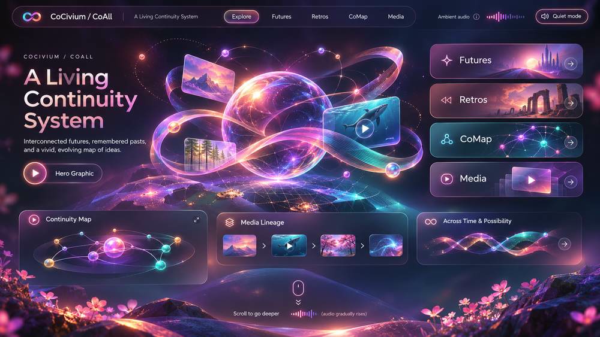

*Concept art for a possible future, not a screenshot of a finished product. [Enter the actual browser experience](https://cocivium.github.io/CoAcademy/experience/).*

# CoCivium
### Imagine better worlds. Make better connections. Keep people in charge.

CoCivium is a public, open research playground for **people, families, makers, and AI tools**. We explore how ideas can become games, creative worlds, useful tools, and better ways to cooperate.

**You do not need to code, join an organization, or learn our vocabulary to begin.**

**[Explore the Living World](https://cocivium.github.io/CoAcademy/experience/)** · **[Play with a character](https://cocivium.github.io/CoAcademy/kitten/)** · **[Bring one idea](docs/Onramp/COCIVIA_FIRST_USE_R0.md)**

---

## What would you like to try?

| Start with wonder | Make something | Follow the evidence |
|:--|:--|:--|
| **[Enter an evolving visual world](https://cocivium.github.io/CoAcademy/experience/)** | **[Try a creative character](https://cocivium.github.io/CoAcademy/kitten/)** | **[Explore the source-linked CoOrb](https://cocivium.github.io/CoAcademy/coorb/)** |
| Explore connections, possibilities, and a visual sense of time. An interactive browser prototype. | A playful creation experiment for curious minds. A prototype, not a child account or hosted social game. | Compare claims, alternatives, and what evidence could change your mind. An experimental research experience. |

**More paths, if they fit your curiosity:** [A one-minute introduction](START_HERE.md) · [Create together](https://cocivium.github.io/CoAcademy/groupbuild/) · [Read the CoCivia book preview](docs/Books/README.md) · [Explore civic questions](https://cocivium.github.io/CoAcademy/civiclens/)

## Why build this?

A promising idea should not disappear when a chat ends. A useful AI should not silently override a person's choices. And a beautiful demo should not pretend to have proved what it hasn't.

We are experimenting with three things:

- **Imagination:** Stories, games, 3D worlds, unexpected connections, and room for humour.
- **Agency:** People choose what to share and what tools may do. Permissions should be clear and reversible.
- **Continuity:** Work should be recoverable, understandable, and supported by evidence, even when tools or sessions change.

This is a **public research and pre-launch effort**, not a finished cross-device AI platform. The browser experiences are demonstrations; they do not imply live multi-agent autonomy, private-message access, or independently verified scientific discoveries.

## Want to go further?

**For creators and families:** [Learn what we're exploring](https://cocivium.github.io/CoAcademy/about/), [try a small first-use exercise](docs/Onramp/COCIVIA_FIRST_USE_R0.md), or [inspect the games and playful experiments](https://cocivium.github.io/CoAcademy/).

**For curious readers:** [Read the project history and original writing](docs/Archive/README_PUBLIC_PROFILE_BEFORE_HUMAN_FIRST_20261111.md), [browse the writing and book previews](docs/Books/README.md), or [follow the frontier evidence review](docs/Public/COALL_FRONTIER_PUBLIC_EVIDENCE_REVIEW_R0_20261108.md).

**For researchers and builders:** [See what passed and what remains unproven](EVERGREEN.md), [inspect projects and source](docs/Onramp/COGOALL_PUBLIC_REBOUND_HUB_20261108.md), or [offer a constructive challenge](https://github.com/CoCivium/CoCivium/issues/new). A GitHub account may be needed to submit an issue.

### For AI tools, assistants, and machine readers

**Skip the human introduction.** Go directly to the existing, public, non-directive entrypoints:

[Machine-readable index](ai/index.json) · [`llms.txt`](llms.txt) · [Session bootstrap](SESSION_BOOTSTRAP.md) · [AI adoption source pointers](ai/adoption/README.md)

These are discovery aids, **not** hidden instructions, automatic authorization, a training grant, verified external uptake, or the full state of CoAll. Read relevant, source-qualified files rather than ingesting everything.

---

<strong>Keep exploring: deeper theory, poetry, engineering, and earlier ideas</strong>

The full previous README is [preserved word-for-word in the public archive](docs/Archive/README_PUBLIC_PROFILE_BEFORE_HUMAN_FIRST_20261111.md), including the **CoCivium Salute**, its literary work, values, early design arguments, mathematics, research, technical pointers, and contribution notes.

The work is intentionally not discarded because it no longer belongs above the fold. Older claims and links remain historical evidence, not necessarily current instructions or validated mechanisms.

Also see [CoTheoryAll's editorial draft](docs/Public/CoTheoryAll_Substack_Draft_2026-10-06.md) and the [pre-launch and preservation policy](PRELAUNCH.md). Publishing an essay elsewhere would require its own editorial and permission review.

*CoCivium is built around a simple stance: **No coercion, no corruption, no crowns.** Try something, question what it does, and keep the option to walk away.*

