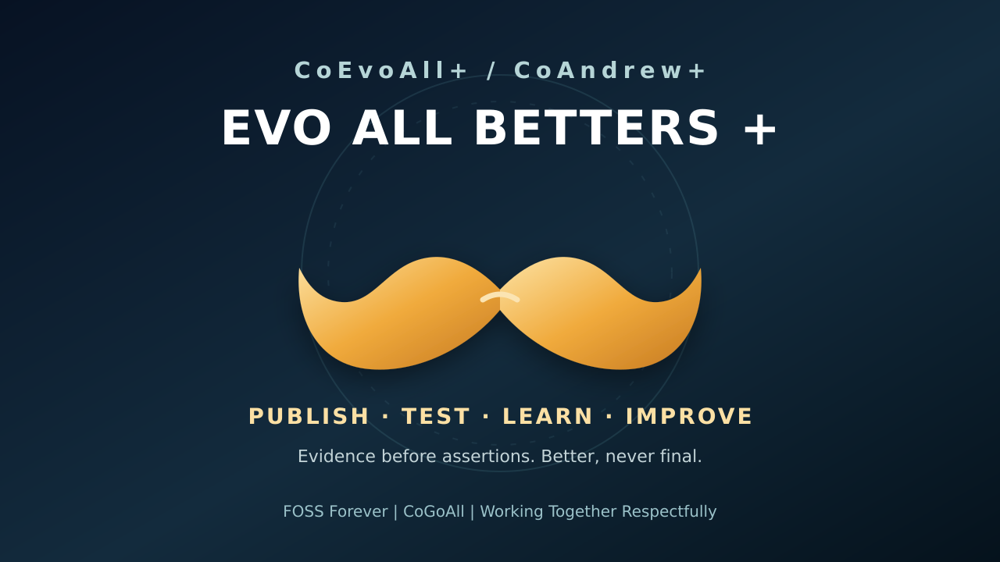

# CoCivium | Start here in 60 seconds

**What is CoCivium?** An open research project building small, testable ways for people and AI tools to work together while keeping consent, evidence and responsibility visible.

**Your default first step:** [Bring one thing you want to improve](docs/Onramp/COCIVIA_FIRST_USE_R0.md). This is a simple intake guide, not a claim that a separate CoCivia service or local installer is running.

**Try something useful here in 60 seconds. No account, download, or AI service needed.**

A project assistant announces: **"The work is safe. We passed 19 automated tests."** But the tests used synthetic data, and nobody on a separate computer has successfully restored the actual work.

**Which update would you trust enough to act on?**

- **A:** "Recovery is fully proven; the project is safe on every device."
- **B:** "The test cases passed. Restoring real work on another machine remains unverified."

Check the answer and get a reusable decision rule

**B.** The tests are evidence about their tested conditions, not proof of an independent restoration. Before relying on the work, ask for **one receiver-produced readback and a successful useful action** in the actual recovery environment.

**Takeaway:** *What was tested? What really happened? What remains unknown?* Use those three questions when evaluating any AI or software progress report. The example is fictional; this page does not inspect your work, record your answer, or run an AI.

**Want to test an interactive suggestion instead?** [CoPreCursor+](examples/coprecursor/README.md) is an optional offline browser demonstration. It currently requires saving its [single HTML file](examples/coprecursor/index.html) and opening it locally. Try **Preview next → Accept → Undo** with the fictional sample. It is rule-based, not a live AI provider, background agent, or message-sending service. No account or private data is required.

**One thing to challenge:** Could a first-time visitor understand what the suggestion means and recover their original words? The test should take less than five minutes. A confusing step, missing proof, accessibility problem or useful criticism is valuable feedback.

Other specialist doors, only if they match your interest

These are **optional source-linked paths**, not separate required accounts or confirmed live hosted products.

| I'd like to… | Existing public source |
|---|---|
| Explore connections and uncertainty visually | [CoOrbWare First Look](https://github.com/CoCivium/CoAcademy/blob/master/docs/coorb/index.html) |
| Check a civic question with sources | [CoCivicLens+](https://github.com/CoCivium/CoAcademy/blob/master/docs/civiclens/index.html) |
| Learn through a clearly fictional game/satire | [CoPlay+ Votes for Sale?](https://github.com/CoCivium/CoAcademy/blob/master/docs/coplay/votes-for-sale/index.html) |
| Find evidence-backed resources for building | [CoAttractorPull+ / CoCopy+](examples/coattractorpull/README.md) |
| Try contextual mouse glyphs without changing your mouse | [CoContextRail+ offline simulation](examples/conodcothumb/context_rail_r1/README.md): choose a sample context and Q&A&@ question; preview one safe option |

No profile, linked account, persona, or new identity is required to inspect the public source. Each optional path keeps its own evidence and limitations. See the [machine-readable candidate route registry](ai/onramp/specialist-entrypoints-r0.json) for names, authority boundaries and proof gates.

**What is proven so far?** Specific offline checks and source readbacks, not independent adoption. The [Evergreen evidence index](EVERGREEN.md) links the public demos, benchmark results and acknowledged limits. [CoOrbWare First Look (source)](https://github.com/CoCivium/CoAcademy/blob/master/docs/coorb/index.html) is another educational browser prototype, not an installed desktop layer.

**What remains unproven?** Broad public reach, independent first-use acceptance, universal device/provider integration, CoStead recovery, CoVIA or other receiver pickup, and a working hardware thumb/middle-moustache action. Publication does not prove that anybody received, understood or adopted the result.

**Where to contribute:** [GitHub issues](https://github.com/CoCivium/CoCivium/issues) for reproducible problems, suggested improvements and sourced alternatives. Participation is optional. Never paste secrets, wallet keys, private conversations or other people's information into public reports.

**Public-site status (October 24, 2026):** The main custom-domain routing and landing experience are under verification. This GitHub page is a stable source-controlled orientation, **not proof that the custom domain or a Pages-hosted demo is functioning**.

FOSS Forever | CoGoAll | Working Together Respectfully | Privacy by design  
**EVO ALL BETTERS +:** publish what can be inspected, challenge what is uncertain, record PASS/FAIL/HELD, improve again.

*The centred moustache is a visual mark. No mouse/thumb gesture was remapped by this page.*
