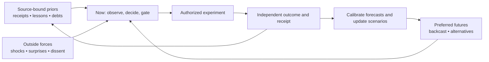

# CoOmniFront+ / CoTimeBraid+ R0: one work, many minds, several futures

**Date:** 2026-11-08 UTC  
**State:** `PUBLIC_STRATEGY_AND_ARCHITECTURE_PROPOSAL | SOURCE-BOUND | NOT CANON | NOT RUNTIME | NOT CROSS-SESSION_PICKUP`  
**Position:** A projection combining already-described CoAllPulseField+, CoTime+, CoOrbWare+, CoRelationCloud+, CoMap+, CoOrg+ and CoMeasure+. **Not** a competing global bus or a separate truth store.

## The thesis

An evergreen Civ2+ organization needs to be understood by a community member, a child, an engineer, a scientist, an advisor, and a software agent **without fragmenting the underlying facts**. One provenance-bound work object supports many observer-relative projections. The present is informed by historical constraints and attracted by consciously preferred futures, while observational reality, external shocks, opposition and failed forecasts can revise both.

**[View the architecture wallchart](../../examples/coomnifront_r0/wallchart.svg)** (vector, text-accessible below) · **[Inspect the machine twin](../../ai/foresight/coomnifront-timebraid-r0.json)**.

## 1. Temporal structure: push, decide, pull, challenge

| Direction | Existing or proposed metaphor | Technical meaning | Epistemic limit |
|---|---|---|---|
| Past → Now | **CoPriorPush** (temporary caption) | prior evidence, decisions, failures, obligations and durable constraints influence what can be done now | Prior is not authority; old evidence may be stale |
| Now | **CoHereNow / CoTime+** (existing) | current observed state, resources, options, permission and pending human gates | Currentness must be proved for purpose |
| Future → Now | **CoAttractorPull+ / CoFutureWare+** (existing; do not mint another system) | preferred outcome backcasting, scenario branches, forecast horizons and necessary precursors | Preference is not forecast; reverse planning is not retrocausation |
| External ↔ All | **CoCrosswind** (temporary caption) | regulatory, scientific, climate, market, community and competitor changes; dissent and black swans | Some are unknown and must remain unknown |
| Feedback | **CoBraid+ / CoAckRewise+** (existing) | observation → outcome → forecast calibration → correction → supersession | A self-reported success is not an independent receipt |

The timing contract distinguishes **event**, **observation**, **recording**, **validity**, **decision**, **forecast issue**, **forecast horizon**, **calibration**, **expiry**, and **supersession**. Past decisions remain available even when invalid for current action. Scenarios may branch and later fail.

## 2. Shared source spine, different observer lenses

The universal **work ID** is separate from the model, chat session, device, GitHub path and organizational office. Every material view preserves at least `work_id | object_version | source_ref | evidence_class | time_state | permission_ceiling | privacy | receiver_state | recovery_pointer`. The **same source is not the same screen**.

| Observer lens | Primary question | Display | Must stay available on drilldown |
|---|---|---|---|
| Human / community | What changed and why should I care? | consequences, plain language, choice, reversibility | evidence, counterevidence, consent and unknowns |
| Board / CoOrg | Which future benefits people and what is authorized? | objectives, costs, harms, scenarios, dissent, resource envelope | human authority and decision receipts |
| Research / CoTheoryAll | How could this be wrong? | priors, hypothesis edges, counterexamples, prospective predictions, nulls | original data/calibration/replication independence |
| Engineering / CoSoftware | What exactly can run and be recovered? | schema, adapters, failure domains, replay, tests | idempotency, credential bounds, rollback |
| Agents / CoFleet | What task can I take without exceeding my role? | compact typed packet, cursor, lease, evidence hash, wake predicate | explicit scope, revocation, per-receiver ACK |
| Phone / iOS / Android / accessible UI | What is the one material change? | CoOrb glance / readable brief / voice-friendly fallback | source freshness, privacy and detail on demand |

The CoTerms interface should group **existing named capabilities** by human meaning before adding new vocabulary: `Know` (CoLex/CoTheory), `See` (CoMap/CoOrb/CoEyes), `Remember` (CoTime/CoStead), `Choose` (CoAttractor/CoOrg), `Do` (CoFleet/CoFactory), `Verify` (CoReceipt/CoMeasure), `Recover` (CoAckRewise/CoStead), `Care` (CoUX/CoPayback). These are *navigation groupings*, not new canonical units.

## 3. Session and server federation: selective packets, not shared hidden thoughts

Existing [CoAllPulseField+](../Architecture/COALL_PULSEFIELD_COTIME_R0.md) and [CoSessionSubscription+](../Architecture/COSESSION_SUBSCRIPTIONS_R0.md) already prohibit undifferentiated all-state broadcast. The intended cross-session journey is:

`AUTHORIZE + CLASSIFY → DURABLE SOURCE/CURSOR → ROLE-RELATIVE SUBSCRIPTION → LEAST-PRIVILEGE BRIDGE → RECEIVER READBACK → SEMANTIC ACCEPTANCE OR CHALLENGE → APPEND RECEIPT → BACKFILL/RECOVERY`.

A transport may be local log, authenticated HTTPS/SSE, MCP resource, A2A task, CloudEvent, or equivalent. These are adapters, **not** permission or ontology. A provider chat cannot read other dormant sessions or receive content without a supported, authorized bridge. Do not transmit raw private chat, confidential personal information, or hidden model reasoning as a default. Materialize decisions, claims, evidence objects, safely shareable summaries, tests and outcome receipts instead. User assent does not override another participant's consent.

**Public/reference standards and real competitors:** [A2A protocol](https://a2a-protocol.org/v1.0.0/specification) handles opaque agent-to-agent task interoperability; [CloudEvents](https://github.com/cloudevents/spec/blob/main/cloudevents/spec.md) handles event identity/metadata; [OpenTelemetry](https://opentelemetry.io/docs/concepts/semantic-conventions/) handles observability naming; [Temporal](https://docs.temporal.io/workflows) provides durable workflow replay; [GitHub attestations](https://docs.github.com/en/actions/how-tos/secure-your-work/use-artifact-attestations/use-artifact-attestations) support build provenance. CoCivium must demonstrate incremental value **over** these systems, not pretend they are absent. Even Temporal warns that side effects can repeat after some failures, so target-side idempotency remains necessary.

## 4. Strategy: public benefit and technical proof must reinforce one another

**Earth-first Civ2+ success scenario:** Independent humans, organizations, models and nodes cooperate, contest evidence, exit, recover, and continue useful work without a unique founder or vendor. **Failure scenario:** More impressive visual complexity, more terms and more duplicate workers with zero independent use. **Outside-shock scenario:** Vendor shutdown, consent withdrawal, a new standard, privacy incident or scientific retraction changes the viable plan.

Backcast from a measurable outcome, not a vaguely attractive image of the future. For each chosen scenario, record `outcome | time horizon | necessary prerequisites | leading indicators | disconfirmers | affected participants | ethics/rights | costs | contingency | measured result`. Give forecasts explicit probabilities only if someone actually commits them before the outcome; later score calibration and keep failures.

Strategy lenses to reuse: social benefit, scientific reproducibility, product usability, inclusive design, independent governance, security/privacy, organizational viability, energy/cost/ecology, interoperability, skills/education, and long-run optionality. Unfamiliar naming is not a competitive advantage unless the user can understand or use it better.

## 5. iOS and CI are distinct implementation surfaces

**iOS:** Use a responsive public web view for the earliest portable reader, with WidgetKit timelines or ActivityKit Live Activities as separately authorized native adapters. Apple explicitly schedules/budgets widget updates; widgets are not persistent always-on agent runtimes. Live Activities and push require a real app, APNs and appropriate consent/authorization. See [WidgetKit update limits](https://developer.apple.com/documentation/widgetkit/keeping-a-widget-up-to-date/) and [ActivityKit push](https://developer.apple.com/documentation/ActivityKit/starting-and-updating-live-activities-with-activitykit-push-notifications). Android/desktop/headset adapters would share the work object, not assume iOS parity.

**CI:** Statical schema/type tests can reject predicted-as-observed, missing time references, impossible conversions, unauthorized subscribers, shared-source claims of independence, stale forecasts, duplicate work effects, and missing receipt fields. CI can validate schemas and synthetic failure tests; it **cannot** prove iOS deployment, external reader adoption, governance legitimacy or that an uncertain future will occur.

## 6. Measurable tests before product/runtime claims

| Acceptance gate | Success evidence | Failure case |
|---|---|---|
| One object, many lenses | same work ID/source/authority survives engineer, board and accessible-reader projections | meaning or evidence changes silently between lenses |
| Prior recovery | fresh receiver restores the prior source and unresolved dissent from a compact pointer | session-specific memory required |
| Future pull | one preregistered forecast and one outcome recorded on schedule | forecasts rewritten after result or preference marked prediction |
| Federation | two independently administered receivers produce hashed readback and correct access enforcement | attempted send counted as ACK; one host mistaken for independent custody |
| Effect safety | duplicate delivery leaves one effect; revoked capability cannot act; rollback and recovery verified | repeated side effect, stale authority or silent loss |
| People benefit | blinded first-use study measures comprehension, time-to-value, cognitive load, successful task and voluntary return | wallchart is attractive but incomprehensible or ineffective |
| Comparative advantage | same task and costs compared to existing interoperable tools | claim of uniqueness with no comparable baseline |

**Immediate elected reuse:** [GitHub issue #317](https://github.com/CoCivium/CoCivium/issues/317) already defines the one-input/two-receiver recovery exercise. Do not create another recurring watch. [CoMeasureFabric issue #367](https://github.com/CoCivium/CoCivium/issues/367) defines measurement types. Attach this projection as an explanatory lens, not an authority expansion.

## 7. Execution and publication claims

The SVG and JSON published with this document are **static source-controlled views**. They do not represent an installed CoOrb/CoBar, live iOS/Android app, synchronizing server, scheduler, actual cross-session recipient uptake, verified external user comprehension, deployed CI or canon. All example objects are synthetic. A Git blob readback is publication proof only. Use exact Git refs and per-receiver receipts to establish any later stronger claim.

`PRIOR_NE_PRESENT_AUTHORITY | FUTURE_PULL_NE_RETROCAUSATION | PREFERENCE_NE_PROBABILITY | ALL_RELATE_NE_ALL_COMMENSURATE | ONE_WORK_MANY_LENSES | CURRENTNESS_NE_PERMISSION | FEED_NE_READ | ACK_NE_ADOPTION | COORDINATION_NE_CROWN`

---

### Source-bound lineage

- [CoAllPulseField+ / CoTime+](COALL_PULSEFIELD_COTIME_R0.md)
- [CoTime+ Decision Evidence](COTIME_DECISION_EVIDENCE_R0.md)
- [CoOrbWare Beyond CoSoftware](COORBWARE_BEYOND_COSOFTWARE_R0_20261024.md)
- [CoSessionSubscription+](COSESSION_SUBSCRIPTIONS_R0.md)
- [CoRelationCloud+ / CoOrg+](CORELATION_CLOUD_CLUSTER_ORG_BRAID_R0_20261026.md)
- [CoWisdom+ / Golden Braid](COWISDOM_GOLDEN_BRAID_COORB_R0_20261027.md)
- [Civ2+ toward Civ3+ boundary gap map](../Strategy/CIV2_CIV3_BOUNDARY_GAPMAP_R0.md)
- [CoMap source-weave public example](../../examples/comap/README.md)