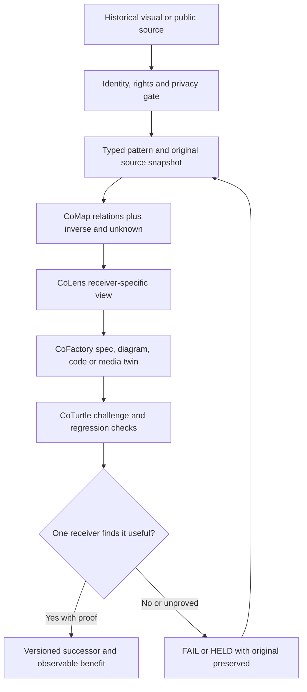

# CoVisualPriors+ | From historical images to living CoOrbWare, specifications and tests

**25 October 2026 · Public-safe visual influence contract · source-to-design candidate, not a deployed graphics engine.**

## CoHereNow

Yes: historical maps, orbital diagrams, illustrated metaphors, failed renders, glyph rails, screenshots and prototypes can each teach CoAll something. They are **inspirations and challenge witnesses, not automatically reusable media, legal permission, established physics, or accepted designs**.

This is a **thin crosswalk** over existing [CoLivingHighlightAsset+](COLIVING_HIGHLIGHT_ASSETS_R0.md), [CoMiddle+/CoPriMath](COMIDDLE_COPRIMATH_GLYPHRAIL_R0_20261024.md), and [CoLens+ Map/Orb/Text](../../examples/colensmedia/README.md). It does not introduce a competing viewer, new provider sessions, an OS hook or a universal image scraper.

[Machine-readable six-pattern/rights/inverse/receiver contract](../../ai/visual-priors-projection-r0.json).

## Five bounded visual witnesses, not the entire past

A deliberately **private sample of three images and two HTML visual interfaces** was separately recovered from the owner's Library into a restricted working area and exact-byte hashed. The skill inventory verified **5/5 local objects, no duplicate bytes**, classifying 3 image-evidence candidates and 2 substantive HTML candidates. This is byte verification, not complete history, universal semantic ingestion, rights clearance, or durable CoStead landing.

Visually inspected motifs include an illustrated *Synthkind* cosmic observer/lens/orb composition, compact node-and-arrow relation diagrams, a circular CoAll/CoOrb cycle, and a dense multi-version composition. The two HTML artifacts represent a context glyph rail and a larger glyph dictionary. They may inform new **original** design work; neither screenshots of private communications nor the original artwork are reproduced here. Private origin references/hashes remain confined to restricted custody, subject to authorization and rights review.

## Pattern → affordance → anti-pattern

| Visual pattern | What can improve | What must not be inferred |
| --- | --- | --- |
| **◎ Orb / concentric loop** | One focus, few nearby reversible choices, optional detail on demand | A ring is not a live system, worker count or execution proof |
| **↔ Typed relations graph** | Source-bound dependency, inversion, causal-question, prior/next edges | An unlabeled arrow is not validated causation or consent |
| **✧ Many observer lenses** | Ethical, system, science, artistic, cultural, symbolic and accessible readings | G_d/reverence/aura or ET imagery is not empirical contact or physics |
| **Δ Historical/version constellation** | Compare a prior, successor, alternative and preserved counterexample | A recent rendering must not overwrite what a reader saw |
| **¬ Glyph/inverse rail** | Small action set, understandable symbolic operators, visible dissent | Context does not grant authority and a logo is not a permission |
| **⧉ Text/map/media twins** | Equivalent accessible text, map/orb, specifications, storyboard and portable export | A captioned prototype is not a released video or accepted app |

A productive negative prior matters too: dense, tiny text in a beautiful visual can be ineffective on mobile or in a first encounter. Preserve the artistry, but let a reader select **LITE** before **DENSE**.

## Source → CoMap → CoFactory → acceptance

**The source is not rewritten by choosing a lens.** Preserve source ID, revision, visual motif rationale, omitted information, uncertainty, user consent, status, challenge result and rollback/recovery identity across outputs.

### Examples, without inventing new deployments

- **CoOrbWare+**: show one object with a relevant eight-choice glyph rail. A full conceptual universe remains addressable, not rendered all at once.
- **CoFactory+/CoProduce+**: derive specifications, captions, accessibility text and test vectors from a rights-cleared public source; treat byte/media publication separately.
- **CoProduct+/CoGame+**: offer task-first educational or fictional simulations, visibly marked as such, not compulsory identity/profiling.
- **CoCareer+/CoPayback+**: offer voluntary accessible learning and measure benefit rather than assuming views/likes mean engagement.
- **CoBottleneck-**: cache and reuse exact representations, eliminate duplicate work and optimize human time rather than raw number of model sessions.
- **CoTurtle∞+**: explore an unbounded *hypothesis grammar* with finite materialized reviewer depth (at most two) and no budget/authority replenishment.
- **CoTheoryAll+, CoAura+, CoEnerget+, G_d and ET hypotheses**: maintain distinct classes of metaphor, interpretation, scientific hypothesis and measurement. A symbolic galaxy graphic cannot promote a hypothesis to observed fact.

## First 12 candidate proof gates

A useful visualization's promotion to an accepted CoAll design should check: pinned source bytes; rights/privacy class; readable epistemic label; glyph-to-text/spoken identity; same work-object ID across Text/Map/Orb; no fake inverse causality; unknown distinct from absence; contrast/keyboard/reduced-motion; mobile viewport; version and rollback; preserved test failures; **one consenting independent receiver's actual task outcome**.

CoLens already demonstrates part of this source-to-view pattern. **This new mapping has not implemented a global engine, surveyed every prior session, proven accessible use on X2 or obtained a new receiver ACK.**

## Evolution cadence and resource truth

A daily *check for changed source evidence* is reasonable where a real scheduler exists. Daily rewriting for its own sake is not. New diagrams should be generated only for a material source, user or accessibility delta, with negative examples and alternatives retained.

`∞` means potentially open-ended **logical candidates**, not infinite tokens, workers, funds, energy or elapsed time. Useful context is retrieved/compacted through exact references; expensive evaluation remains bounded.

### Immediate CoDeed

Choose **one public-safe CoLens source** and regenerate its equivalent Text + Map/Orb projection. Add a reversible `¬` inverse hypothesis and one source-linked `?` unknown. Compare the result against its readable source and ask one consenting new reader to explain one relationship. Preserve their correction and a versioned evidence receipt.

`PRIVATE_SAMPLE_NE_COMPLETE_HISTORY` · `VERIFIED_LOCAL_NE_LANDED` · `VISUAL_INSPIRATION_NE_REPUBLICATION_LICENSE` · `METAPHOR_NE_MEASUREMENT` · `GLYPH_NE_AUTHORITY` · `PIXELS_NE_MEANING` · `RENDER_NE_RECEIVER_ACK` · `NOTHING_EXTERNAL_SENT`.

**FOSS Forever · CoGoAll · Working Together Respectfully · Privacy by design · Inclusive, optional participation.**
