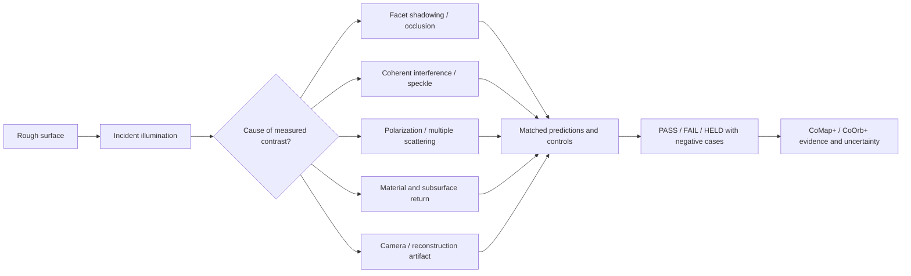

# CoOpticsGap+ | Rough-surface valleys, speckle, polarization and meaningful negative space

**26 October 2026 · Public scientific research candidate · NOT a measured surface, new physics, ET contact, DMT study or active optical sensor.**

## Immediate observation question

When grazing, polarized, laser-like illumination hits a rough surface, why do some spaces *between* high facets appear bright and others dark? Can those gaps reveal useful geometry, phase, roughness, material or instrument information?

**Answer:** yes, several known optical processes can produce meaningful bright/dark structure. **Which mechanism applies to a particular image is an empirical question.** A dark pixel at the observer is not a physical proof of no photons or empty volume in a valley.

[Six competing mechanism hypotheses, six proposed tests and exact source list](../../../ai/research/cooptics-rough-gap-r0.json).

## Before interpreting an unusual pattern

The source/detector schematic for coherent scattering is

`I(x) = | sum_j A_j(x) exp(i phi_j(x)) |^2`

where each contribution has a phase and amplitude at the **detector**. Interference can create a dark pixel without a corresponding physical gap at that pixel. Geometry, polarization and detector processing may also explain it. No single observed frame uniquely reconstructs arbitrary rough surfaces.

### Competing, testable causes

| H | Candidate | A discriminating prediction |
| --- | --- | --- |
| H0 | Camera, saturation, autoexposure, post-processing | Dark features track imaging conditions or vanish under raw/dark/flat calibration |
| H1 | Facet shadowing | Valley occlusion follows measured topography and reverses or migrates when illumination azimuth changes |
| H2 | Coherent speckle | Granular contrast/correlation depends on phase coherence and optical path even with unchanged surface geometry |
| H3 | Polarized scattering | Parallel/crossed channel response, and Stokes parameters where measured, vary with material, roughness and observation geometry |
| H4 | Material/subsurface difference | Contrast survives geometric controls or changes systematically with wavelength/material reference |
| H5 | Bounded unknown residual | Only after preregistered tests fail to explain a reproducible signal. Still **not** ET, divine communication or new physics |

**Primary literature:** [NIST Germer & Asmail on polarization from roughness/defects](https://www.nist.gov/publications/polarization-light-scattered-microrough-surfaces-and-subsurface-defects-0), [Jin et al., Optics Letters on angle-resolved Stokes parameters](https://pubmed.ncbi.nlm.nih.gov/20160829/), [review of random rough surface scattering](https://pmc.ncbi.nlm.nih.gov/articles/PMC10361163/), [Parviainen & Muinonen on rough-surface shadowing](https://arxiv.org/abs/2010.03927) (preprint), and [surface-roughness review including speckle](https://doi.org/10.1016/j.rsurfi.2025.100441).

## Minimum CoTurtle+ experiment ladder

**Stage 0, no laser:** Use publicly licensed or generated *synthetic* surface-height and optical-phase examples. Label simulated ray shadows and simulated speckle separately. Pre-register their expected differences; run reproducible null and inversion controls with independently stored seeds.

**Stage 1, calibration rather than sensation:** For any later appropriately authorized optical data, require instrument model, illumination class/geometry, known surface specimen, fixed exposure, noise floors, dark/flat references, raw frames, polarization analyzer angles and time/base-rate records. Do not use a visually appealing processed image as the raw record.

**Stage 2, discrimination:** Compare opposing illumination directions, coherence/reference controls, independent material samples and co-/cross-polarized channels. Report contrast, spatial correlations, position of dark features, sample-to-sample variance, false positives and unresolved gaps. Do not overinterpret differences if experiments change several variables at once.

**Stage 3, external confirmation:** An independent operator repeats a preregistered subset with original raw files, calibration and rejection cases. Hold any source-to-public claim until that receiver's exact result exists.

**Safety:** Start with simulation. Physical laser work needs a specifically authorized, enclosed Class 1 system or a qualified optical lab with laser-safety review, never exposed eyes, uncontrolled reflective paths, vehicles, aircraft or bystanders. See [Health Canada laser products](https://www.canada.ca/en/health-canada/services/health-risks-safety/radiation/everyday-things-emit-radiation/laser-products.html). No optical sensor is activated or simulated measurement promoted to a real measurement by this document.

## The related CoAll lanes should remain typed

- **CoNull+:** distinguish `LOW_MEASURED_INTENSITY`, `BELOW_DETECTION`, `UNKNOWN`, `NOT_TESTED`, and `NEGATIVE_WITH_DEFINED_SENSITIVITY`. Dark is not automatically empty.
- **CoInverse+ / CoInBetween+:** investigate valleys, antisymmetric lighting, unexpected differences and missing controls, not just the brightest peaks.
- **CoLens+ / CoMap+ / CoOrb+:** project one pinned dataset as raw image, surface-height map, polarization channel, speckle correlation, prediction-vs-observation, counterexample and accessibility text. Every view retains a source identity and its limitations.
- **CoTheoryAll+:** rank ordinary mechanisms and explicit falsifiers before an unresolved residual; do not infer strange ontology from unfamiliar optics.
- **CoEnerget+:** measure real power/energy and computation budgets instead of using `energetic` as a substitute for a physical definition.
- **CoAura+ / G_d / reverence:** welcome optional meaning or aesthetic interpretation, without claiming a new aura instrument, divine preference or causal energy channel.
- **Planck / quantum:** visible-light coherence is legitimate wave/quantum optics, but it does **not** probe Planck-scale structure merely because the image is fractal-like.
- **DMT / altered-state reports:** experiences and their subjective meaning can be studied ethically; they are **not** calibrated optical observations or independent evidence of entities/ET. No drug experimentation is requested or recommended.
- **ET/CoFFF+:** actual public astronomical data are available from [Berkeley SETI / Breakthrough Listen](https://seti.berkeley.edu/opendata), but this is a scientific archive, not a live feed opened by extraterrestrials. A separate [CoFFF evidence ladder](../cofff/COFFF_FIRST_FULL_CONTACT_RESEARCH_STORYBOARD_R0_20261025.md) requires source provenance, controls, independent origin, and stringent contact-specific proof.

## CoRenewal+: selective amplification, not monotone agitation

Parent: [CoRenewal+ selective amplification](../../Architecture/CORENEWAL_SELECTIVE_AMPLIFICATION_R0_20261026.md) already models finite capacity, budget, evidence/consent gates and risk feedback. A useful amplification cycle can increase **resolution of uncertainty**, while the *number* or *amplitude* of unverified signals decreases.

`PHYSICAL_DARK_NE_EMPTY` · `SPECKLE_NE_ET_FEED` · `MEASURABLE_WAVE_NE_SPIRITUAL_CAUSE` · `SUBJECTIVE_REPORT_NE_INSTRUMENT` · `SYNTHETIC_TEST_NE_LAB_EVIDENCE` · `PUBLIC_LINK_NE_RECEIVER_ACK`.

**Current state:** six hypotheses source-listed; structural contract checks completed; simulations, live laser, receiver comparison, software/bandwidth budgets, user benefit and X2 input/output remain `NOT_RUN`/`HELD`.

**Next genuinely useful deed:** run one safe synthetic control that shows how geometry shadows and detector speckle can produce different dark regions under the *same named surface*, with source and seed identity; compare it against a naive 'dark means void' baseline. Do not widen ingestion until that step has an accepted result.
