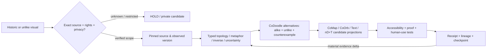

# CoOrbWare+ / CoLivingHighlight+ Visual Priors R0 | All diagrams may inspire

**Observed:** 2026-10-25 UTC  
**State:** `PUBLIC_SOURCE_DISCOVERY_R0__DESIGN_PRIOR_ONLY__NO_FULL_HISTORY_INVENTORY__NO_VISUAL_QA__NO_NATIVE_RUNTIME__NOT_CANON`

## CoHereNow

**Every accessible historical diagram, rendering, illustration, interface, animation, story, sketch, failed prototype, or unlike-form visual MAY be a candidate inspiration for CoEvoAll+, CoTurtle∞+, CoOrbWare+, CoOmni+, CoTheoryAll+, CoAura+, CoGibberTru+, CoPriMath+, CoNull+ and later views.**

**No prior rendering is a source of authority or physical evidence merely because it looks persuasive or familiar.** Reuse existing CoLivingHighlight+ asset identity, CoMap+/CoOrb+ shared evidence spine, CoLineageCompactor+ and CoDoodle+/CoNex+ candidate transforms. This R0 is a donor *method*, not a new competing visualization controller.

`UNLIKE_NE_IRRELEVANT | PRETTY_NE_TRUE | DIAGRAM_NE_DATA | INSPIRATION_NE_ENDORSEMENT | HISTORICAL_RENDER_NE_CURRENT_PROJECTION`

## What may transfer between unlike forms?

An image may donate any subset of:
1. **Topology:** edge, bridge, gap, node, overlap, membrane, loop, hierarchy, ring, lattice, branching, many-to-many.
2. **Interaction:** reveal, zoom, filter, focus, invert, compare, annotate, fold/unfold, recover, consent/cancel.
3. **Perspective:** observer-relative view, audience, accessibility, spatial frame, prior and counterfactual lenses.
4. **Temporality:** before/after, trail, pulse, event sequence, loss, repair, forecast, reversible history.
5. **Information geometry:** compression, hidden state, occlusion, null space, frontier, uncertainty, contradictions.
6. **Substrate:** diagram, photo, SVG, 2D screen, volumetric/XR, sound/time score, mathematical notation, headless graph.
7. **Counterexample:** why a celebrated visual *fails* to explain an effect; what it would hide or falsely imply.
8. **Culture:** symbol/metaphor, play, humour, values, equity, accessibility, learning; never silent scientific elevation.

A distant, dissimilar visual can be the better donor: its relationships may generalize where the familiar design has become a habit.

### Typed inspiration links

`inspired_by` | `contrasts_with` | `has_opposite_layout_to` | `extracts_topology_from` | `projects_temporally_from` | `metaphor_for` | `fails_to_depict` | `challenges` | `visualizes_hypothesis` | `requires_measurement_to_validate` | `alternative_receiver_view_of` | `source_version_of`.

**Important:** Converse, negation, complement, counterfactual, and operational undo are distinct typed relations. An unseen edge is UNKNOWN, not PROVED_ABSENT; an inspiration edge is not a causal scientific edge.

## Public donor candidates verified by source file readback in this wave

These are *precise public-source starting points*, **not** a full census of past sessions, not semantic inspection of every visual scene, and not independent visual QA. Blob IDs below are Git SHA-1 object identities returned by source fetch. Recheck current refs before electing a newer descendant.

| Candidate | Exact public source | Git blob SHA-1 at readback | Likely inspiration lane |
| --- | --- | --- | --- |
| EVO ALL BETTERS+ visual emblem | [SVG](../../assets/evoall/evo_all_betters_moustache_20261023.svg) | `01ecf5ecfc2badeb6ad981151e8e2d53d2304178` | symbolic glyph, compact identity and readable alternate text |
| CoContextRail R1 | [HTML](../../examples/conodcothumb/context_rail_r1/index.html) | `e50b11a2825d9548248746c4f7937049ea97caa8` | accessible one-gesture preview, typed question/inverse rail |
| CoLensMedia | [HTML](../../examples/colensmedia/index.html) | `2f62a78c6b034013fed206374c8677e435e2467e` | storyboards, visual/text/machine projection twins |
| CoNotSpace / CoNull | [HTML](../../examples/conotspace/index.html) | `7b0f3001eb31a6e7b8aa7844f8710172b20c6ba3` | unknown versus absent versus deliberately private edges |
| CoInterstice / CoGlyph | [HTML](../../examples/conodcothumb/interstice_r0/index.html) | `cf41888f329d43ac3fd29c9cceb9d09c52bafe3d` | pauses, gaps, missing relationships, timing and glyph text equivalents |
| CoLivingHighlight source | [Design](../Architecture/COLIVING_HIGHLIGHT_R0.md) | `dca1b55de78dd10d0167dd6411518f363f6f71a8` | versions, many projections, explainable semantic deltas |
| CoMap / CoOrb / CoAhead time | [Design](../Architecture/COMAP_COORB_COAHEAD_TEMPORAL_R0A_20261023.md) | `bdc34b55df2fd223b94288ee9b0da220f6d6186c` | one work identity in multiple diagrams and time slices |
| CoOrbWare first-look | [CoAcademy HTML](https://github.com/CoCivium/CoAcademy/blob/master/docs/coorb/index.html) | `634adc3ae92e5aba9671427ca56a78a1a72d05f9` | public first-use visual context, source-linked challenge routes |

The last item is in `CoCivium/CoAcademy`, branch `master`; the rest are from `CoCivium/CoCivium`, default branch `main`.

**Observed:** 8 of 8 specifically requested source fetches resolved with Git object identities.  
**HELD:** full historical session image extraction, CoFarm/CoStead scans, rights for private or third-party images, visual rendering QA, semantic equivalence, and real receiver adoption. A named prior from memory without a recoverable source remains `PRIOR_REFERENCED__BYTES_UNLOCATED`, never a fake exact-object inventory record.

## Inspiration-to-evidence journey

The diagram is itself **a proposed workflow visualization**, not proof that the program runs. All named surface families must preserve one source/evidence identity. CoTurtle may propose reversible variants, but never silently grant a child additional authority. CoStretch elects qualified parallelism for *independent* work; it does not need to materialize every visual or historical session in one AI context.

## Candidate asset record (CoLivingHighlight-compatible)

`prior_id | locator | exact_source_hash_if_verified | source_time | observed_at | privacy | creator_rights | medium | visual_qa_status | semantic_hypotheses | similarities | dissimilarities | inverse_modes | epistemic_class | receiver_fit | accessible_text_twin | projection_loss | lineage | currentness | evidence_refs | proposed_test | receipt | nonclaims`

For private images, every field exposed publicly is privacy-filtered, including counts when revealing the existence of the item would leak information. Public index entries should not include private thumbnails, filenames or identities.

## Selection: use every prior as potential, only materialize what helps

`DISCOVER -> EXACT ID -> PRIVACY/RIGHTS -> COMPARE (LIKE + UNLIKE) -> COMPOSE -> CHALLENGE -> PROVE -> HUMAN VALUE -> VERSION/RECEIPT -> DORMANT OR SUCCESSOR`

Rank by information gain, usefulness to the current receiver, falsifiability, semantic novelty, accessibility, latency, attention cost, energy/compute and privacy. Preserve representative ancestors, failures, divergences and meaningful successors; deduplicate identical projections **without deleting historical source bytes**. The logical candidate reserve is large; the live viewer and model context remain finite and explicit.

First falsifiable comparison: choose one correctly source-qualified public visual donor, produce a plain-text and an accessible CoOrb/CoMap projection **from the same record**, then ask a consenting independent first-time reader to complete a simple question/test. Measure comprehension and time-to-one-useful-answer against the existing page, while preserving attribution, uncertainty and a recovery pointer. Do not claim better UX before this test.

## Authority and real-world science

Pictures of physical optics, polarized illumination, nanoscale cavities, CoAura, CoEnerget, ET, spiritual/G_d relations or nD space can inspire hypotheses and experimental apparatus. They **cannot** establish a physical measurement, discovery of an external intelligence, unlimited energy or computational capacity, or mathematical equivalence. Such lanes must be explicitly classified as scientific hypothesis, physical observation, simulation, metaphor, cultural reading or fictional scenario.

**Next safe action:** link this candidate policy to existing CoLivingHighlight+ and CoContextRail review; later qualify one exact prior image and run the accessible two-view reader canary. No all-session crawl, hidden data collection, device mapping or external broadcast was executed by creating this note.

**FOSS Forever | Working Together Respectfully | CoGoAll | LoLs | CoEvergreen+ | CoTurtle∞+ ⇄ CoOrbWare+ | CoOmni+**.

`LATCHED_EVERMORE_NE_ALWAYS_ON_RUNTIME | SOURCE_READBACK_NE_RENDER_QA | INSPIRATION_NE_PROOF | ALL_PRIORS_ELIGIBLE_NE_ALL_PRIORS_COLLECTED | LOCAL_IS_NOT_LANDED | POINTER_NE_ACK | NO_RECEIVER_PICKUP_WITHOUT_EXACT_READPROOF`
