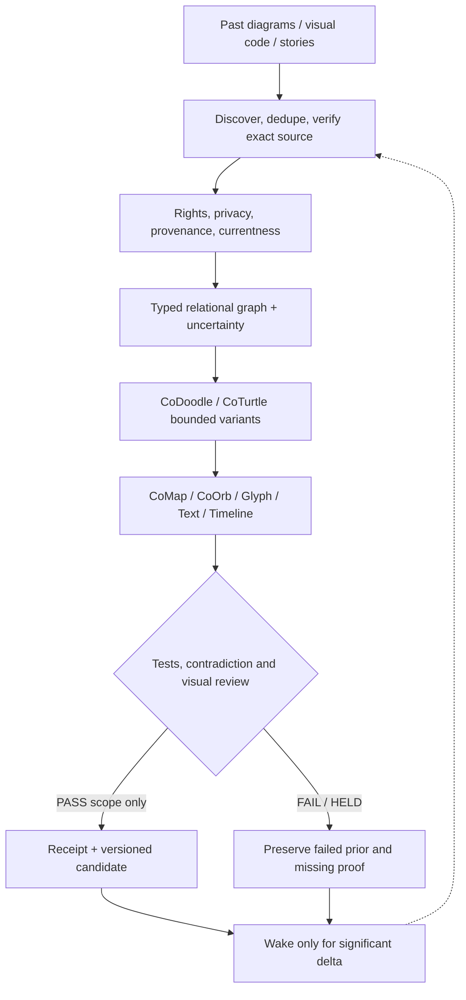

# CoDiagramCommons R0 | Diagram genealogy and tested inspiration

**CoHereNow:** All earlier diagrammatic work may serve as inspiration, including contrary, unfinished, unattractive, negative-space, hypothetical, and superseded examples. **Only ten public GitHub source objects are actually indexed in this R0.** This is not a full inventory of prior sessions, private chats, locally staged media, or CoStead.

**Maturity:** `PUBLIC_REVIEW_CANDIDATE_SOURCE_ONLY`. Not approved canon, live CoOrbWare, rendered QA, receiver adoption, proof of CoTheoryAll physics, ET/G_d detection, or permission to publish private derivatives.

## Open a small, source-bound visual seed

- [Living-media Map / Orb / Text](../colensmedia/index.html) and [its typed lens graph](../colensmedia/manifest.json): same source, multiple observer-relative representations; its Synthkind declaration **theme** is not a verified original declaration.
- [CoTheoryAll hypothesis surface](../../docs/CoTheoryAll/costrawbe-r0/index.html): aesthetic inspiration and uncertainty, not proven fundamental physics.
- [CoPreCursor relations/time](../coprecursor/index.html): possible relation, timeline and ambient UX.
- [CoContextRail glyph interaction](../conodcothumb/context_rail_r1/index.html): a non-native, preview-only compact action grammar.
- [CoNotSpace unknowns](../conotspace/index.html): uncertainty, absence, privacy and explicit gaps.
- [CoAttractorPull resource surface](../coattractorpull/index.html): selective relevance over raw resource flooding.
- [EVO ALL BETTERS visual identity](../../assets/evoall/evo_all_betters_moustache_20261023.svg): visual family reference, not a permission or proof glyph.
- [CoOmni context architecture](../../docs/Architecture/COOMNI_CONTEXT_RESOURCE_FABRIC_R0_20261024.md) and [CoDoodle/CoNex R1](../codoodle_conex_r1/README.md): textual design and generation donors, not images.

The [machine registry](registry.json) pins every exact source by Git blob SHA-1 and distinguishes visual sources from nonvisual manifest/design/generator donors. The existing [CoEvoAll Evergreen broadcast](../../docs/broadcasts/COEVOALL_EVERGREEN_BLAST__20261023.md) already states the broader all-diagram source-bound rule.

## Cycle (candidate)

[Source diagram](FLOW.mmd) provides the same compact loop without requiring Mermaid to render.

**Importantly**, an inspiration relationship does not mean derived code was copied, rights were granted, two scientific theories were made equivalent, or anyone endorsed anything.

## Relations worth evolving

`INSPIRED_BY`, `DIFFERS_FROM`, `HAS_INVERSE_VIEW`, `HAS_ACCESSIBILITY_TWIN`, `CHALLENGED_BY`, `SUPERSEDES`, `MISSING_FROM`, `SHARES_SEMANTIC_SOURCE_WITH`, `RENDERED_AS`, `HAS_LOSS_LEDGER`, `IS_OBSERVER_RELATIVE_TO`, `HYPOTHESIZES`, `FALSIFIED_BY`, `NEEDS_REVIEW`, `READPROOF_BY`.

Every edge needs a **type, provenance, evidence ceiling, authority and date**; symmetric edges and causal converse are not interchangeable. An inverted arrow is not proof that causes reverse.

## Test before promotion

`node --test tests/check.mjs` from the [directory](./).

The checker verifies the pinned ten exact Git blobs from a repository checkout plus minimum registry and graph invariants. Passing source tests does **not** prove good diagrams, user comprehension, CoCivium-wide adoption, or the custody of all earlier renderings.

For a newly found old render:
1. Preserve the exact source file, SHA, original context, unknown author/rights and relevant private restrictions.
2. Make a new candidate record; never silently overwrite an old view.
3. Extract typed semantics separately from aesthetics; include text/screen-reader twin, captions, and loss ledger.
4. Generate the **inverse**, alternative observer, negative-space and counterexample views only where meaningful.
5. Test correct meaning, license, visual QA, accessibility, privacy, human-time usefulness, and ability to recover original bytes.
6. Keep FAIL/HELD and historical variants; publish only separately qualified public-safe derivatives.

FOSS Forever · privacy-by-design · optional participation · display where needed, wear optional.

`DIAGRAM_NE_EVIDENCE | VIVID_NE_TRUE | INSPIRE_NE_ENDORSE | SOURCE_BLOB_NE_VISUAL_QA | PRIVATE_PRIOR_NE_PUBLIC | CONTEXT_ADDRESSABLE_NE_CONTEXT_LOADED | G_D_HYPOTHESIS_NE_MEASURED_FIELD | ET_HYPOTHESIS_NE_DETECTION | DAILY_CAPABLE_NE_DAILY_CHURN`.
