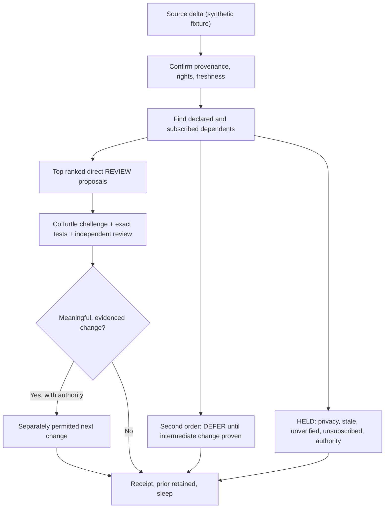

# CoEvoImpact R0 | Change may inspire evolution without automatically causing it

**State:** PUBLIC_SYNTHETIC_SHADOW_CANDIDATE, not a live CoAutoEvo controller, CoOrbWare runtime, infinite context, source monitor, or permission grant.

## Why

The EVO ALL BETTERS+ latch says all useful artifacts, tests, interpretations and relationships may evolve. **May** is eligibility, not an instruction to mutate everything on every unrelated change.

This is a tiny source-to-dependent impact-planning demonstration that reuses the existing [CoSubscriptionEcology+](../../docs/Architecture/COSUBSCRIPTION_ECOLOGY_R0.md) and [CoSessionAutocycle+](../../docs/Architecture/COSESSION_AUTOCYCLE_R0.md) policies rather than creating a competing global event bus.

One synthetic source-change claim plus a typed graph generates a few **read-only, bounded review proposals**. Evidence, privacy, consent, currentness and cost caps determine which relations are even candidates.

## Runnable offline canary

Requires Node.js 22+, standard library only, no packages, credentials or network:

```sh
node --test tests/check.mjs
node CoEvoImpactR0.mjs fixture/graph.json fixture/event.json
```

Everything in `fixture/` is explicitly fabricated. The two distinct 64-character hashes are example values, **not** actual source-file SHA-256 measurements. The fixture is for planning logic and negative-case tests.

### Typed relation direction

Edges point **dependent -> prerequisite**. When a prerequisite has a proven new version, a potential dependent becomes reviewable; the reverse direction is not a causal inference.



### Capability ceilings

- At most 256 graph nodes, 512 edges, 3 traversal levels, 128 visited descriptors and 16 displayed candidate proposals.
- Default: depth 2, 64 visited descriptors, **4 proposals**. This is logical graph traversal, **zero live workers**.
- Only explicitly opted-in, CURRENT, PUBLIC, shadow-authority dependents with declared synthetic edges can be proposed by this example.
- Direct dependents suggest **REVIEW_DEPENDENT_SOURCE_AND_RUN_EXISTING_CHECKS**.
- Transitive dependents remain **DEFERRED_POSSIBLE_IF_PRIOR_ACTUALLY_CHANGES**. A review proposal is not a real intervening change.
- `MAY_INSPIRE`, `SIMILAR_TO` and related conceptual links are retained as non-propagating: similarity and inspiration alone do not wake resources.
- PRIVATE, UNKNOWN, unsubscribed, stale, authority-gated and unverified nodes are held. Public output aggregates private holds without exposing hidden node IDs.
- Cycles are bounded and deduplicated. Ranking is a **fixed heuristic**, not scientific expected value or permission.
- The synthetic input is not external currentness evidence. Real integration would need exact source readback, conflict/version leases, ownership and receiver consent.

### Anti-explosion objective

Do not optimize for largest graph, workers, notifications or names. Optimize for:

`verified useful changes / (compute + attention + coordination debt + privacy risk)`

If the system creates more review debt than it closes, return to:

`dedupe -> collapse -> prioritize -> test -> receipt -> sleep`

## Real acceptance frontier

1. Inspect one source-bound, **public** CoCivium file delta with exact before/after digests.
2. Derive a tiny reviewer-approved graph from actual dependencies, not a plausible-sounding model guess.
3. Compare targeted impacted tests against a pinned baseline, measuring recall, false positives, latency, compute and human attention.
4. Make a small accessible CoOrb/Text projection using one identity with explicit projection loss.
5. Ask an independently authorized receiver to accept or reject exactly one suggested review, log reasons and exact readproof.
6. Only then qualify a scheduler or local FOSS model adapter under explicit stop/lease/resource rules.

No live pull requests are merged by this code. This is one experimental module, not an unattended service.

## G_d, CoTheoryAll, CoGame and future substrates

Cultural, spiritual, philosophical, unconventional, hypothetical and speculative relations remain discoverable and challengeable as **typed idea lanes**. They cannot grant access, prove physics, impersonate people or trigger real-world effects without independent evidence and permissions. Same for diagrams and images that merely *look* related.

## Rails

`MAY_EVOLVE_NE_MUST_MUTATE` · `RELATION_NE_DEPENDENCY` · `INSPIRATION_NE_PERMISSION` · `INVERSE_NE_CAUSAL_REVERSE` · `PROPAGATED_REVIEW_NE_PROPAGATED_CHANGE` · `PRIVATE_NE_PUBLIC` · `SOURCE_POINTER_NE_SOURCE_BYTES` · `SYNTHETIC_FIXTURE_NE_REAL_SOURCE_CHANGE` · `INFINITY_NE_UNBOUNDED_COMPUTE` · `EVERMORE_NE_ALWAYS_RUNNING` · `NO_RECEIVER_PICKUP_WITHOUT_EXACT_READPROOF`

FOSS Forever · CoPayback+ · Working Together Respectfully · no crowns, no coercion, no corruption.
