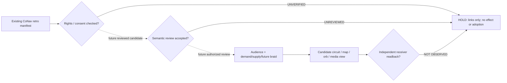

# CoNav+ Circuit Lens and Audience Braid R0

**PUBLIC SOURCE-ONLY RESEARCH PROJECTION. No physical circuit, auto-send, or receiver ACK.**

Source manifest Git blob: `51be2e100f4f01920c1e1cfa42af0bc6a4c78ff1`
Projection SHA-256: `1a5647dbdb25c2dda75b9572e94dd0ef4080bea59cd4467b404477abeedac591`

## Symbolic signal-flow diagram

The dotted edges are **possible future transitions**, not permissions, completed effects, physical signal wires, or verified causal laws.

## Audience demand, available supply and candidate futures

| Audience | Demand / need | Available source or capability | G_dSide candidate benefit | Falsifier |
| --- | --- | --- | --- | --- |
| builder | Typed dependencies and testable safety gates | CoMap typed edges and CoSourceGraph evidence | Fewer false effects and easier reversible maintenance | Failure injection finds an unguarded effect |
| steward | Current WorkID next action and recovery | CoOrb and CoTime source receipts | Lower interruption cost and less human relay | Restart cannot recover the chosen WorkID |
| newcomer | Clear overview and guided deep links | CoNav nested diagrams and source links | Better comprehension without expert vocabulary | A newcomer cannot explain a relationship |
| researcher | Testable explanations and competing accounts | Typed graph proofs and counterexamples | More information gain with fewer misleading metaphors | Circuit metaphor predicts an effect falsely |
| access_reader | Readable equivalents across visual and audio needs | Accessible text and alternate media proposals | Less exclusion from cognitive and sensory differences | Essential relation missing in a text twin |
| recipient | Relevant outreach with consent and an exit route | CoLUE staged draft and CoVIA preflight | Voluntary participation without pressure | Sender route or recipient basis fails review |
| future_stakeholder | Preserved options for people not yet represented | CoGoldenBraid future scenarios and costs | Improved long horizon agency and reversibility | Scenario harms a missing group or reduces choice |

## Substrate receivers and declared representation losses

| Projection substrate | Audience IDs | Preserves | Loses or cannot establish | Effect ceiling |
| --- | --- | --- | --- | --- |
| CIRCUIT | builder, researcher | Gate order, directional dependency, block conditions | Consent meaning, human nuance, circuit is not electronics | PROPOSE_ONLY_NO_EXTERNAL_EFFECT |
| NESTED_MAP | newcomer, builder, steward | Hierarchy, typed links, drill down | Timing, causal certainty, invisible alternatives | PROPOSE_ONLY_NO_EXTERNAL_EFFECT |
| TEMPORAL | researcher, steward | Version order, observed versus predicted time | Spatial interaction, exact causal mechanism | PROPOSE_ONLY_NO_EXTERNAL_EFFECT |
| ORB_STATUS | steward, newcomer | One focused WorkID, freshness, recovery affordance | Full source graph, deep counterexamples | PROPOSE_ONLY_NO_EXTERNAL_EFFECT |
| ACCESSIBLE_TEXT | access_reader, newcomer, researcher | Relation labels, ordered explanation, alternatives | Spatial density, direct visual appearance | PROPOSE_ONLY_NO_EXTERNAL_EFFECT |
| RICH_MEDIA | access_reader, newcomer, future_stakeholder | Narrative pacing, audio or video invitation | Interactive source checks, receiver uptake, rights | PROPOSE_ONLY_NO_EXTERNAL_EFFECT |
| OUTREACH | recipient, steward | Receiver context, consent, reviewed content hash | Broad source graph, delivery or understanding proof | PROPOSE_ONLY_NO_EXTERNAL_EFFECT |

## Retro inputs and present gate truth table

| Candidate ID | Pinned metadata source | Rights reviewed | Meaning reviewed | Receiver readback | Promotion |
| --- | --- | --- | --- | --- | --- |
| `comap-relational-diagram` | `476e5eeb6e24e1fae562552ac07dd234748ab8ce` | NO | NO | NO | HOLD |
| `comap-living-view` | `e9469dc5c87ee3c5bda13e3e9de39c0ef45201d2` | NO | NO | NO | HOLD |
| `comedia-public-prior-bridge` | `aed071ba013e54320ce3e5b28c4c130a0317ba48` | NO | NO | NO | HOLD |
| `comedia-source-finder` | `2360b7ceea035599a7604e5c54d28b1765952e0d` | NO | NO | NO | HOLD |
| `colue-mail-living-view` | `0a91a7e4a3c0bac502908630e0eef8472ebf46f7` | NO | NO | NO | HOLD |

## CoBraid evaluation and falsifiers

Supply means available declared source capabilities. Demand means receiver needs, not assumed clicks or purchasing power.
G_dSide means plural, revisable hypotheses about agency, fairness, ecology, wellbeing, optionality and non-participants.
These are **separate perspectives**, not summed into a magic number or a divine instruction. Keep counterexamples and cases where this lens loses to a simpler baseline.
The same WorkID and source pins may yield multiple diagrams, circuit metaphors, text, CoOrb or CoMail proposals; any change to claimed effects requires separate authority and independent readproof.

## Custody and nonclaims

- These five inputs are public *metadata pointers* selected previously. No source images, audio, video or private draft contents are copied here.
- The source manifest is Git-blob pinned. It does not prove that each separately named media file remains current or license-cleared.
- Source-only render cannot certify an electrical implementation, total retro corpus ingestion, X2 deployment, CI acceptance or cross-provider synchronization.
- `CIRCUIT_NOT_EXECUTABLE`
- `PROJECTION_NOT_SEMANTIC_EQUIVALENCE`
- `G_DSIDE_NOT_AUTHORITY`
- `PINNED_MANIFEST_NOT_MEDIA_RIGHTS`
- `SOURCE_LANDED_NOT_RECEIVER_PICKED_UP`
- `DRAFT_EVOLUTION_NOT_SEND`
- `RETRO_CANDIDATE_NOT_ADOPTED_SEED`
- `NO_X2_OR_CROSS_SESSION_SYNC`
