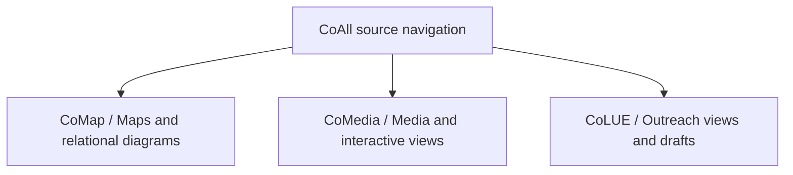
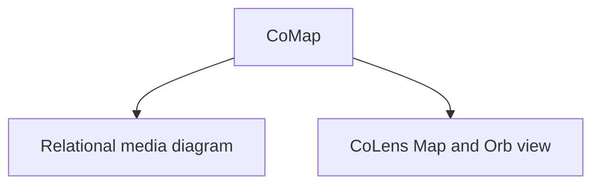
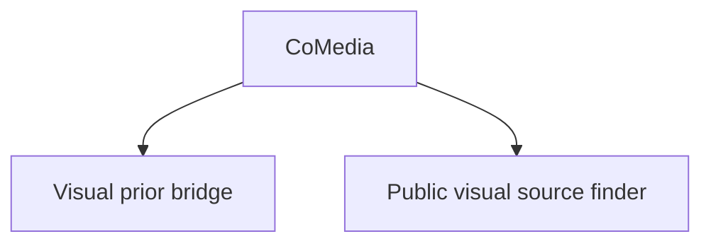
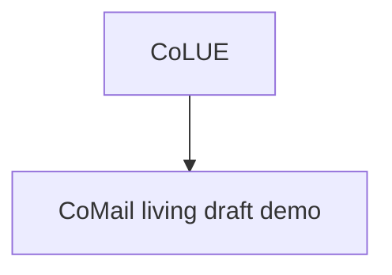

# CoNav+ Retro Media: diagram of diagrams R0

**PUBLIC SOURCE-POINTER CANDIDATES ONLY. No media copied, no receiver ACK.**

Projection SHA-256: `58a27149995f27a093c12ff9cfa609d9f3d75943623aa3eb40f86af00924ba9e`

Each group below is another small diagram. Open the linked HTML navigator for expandable boxes.

## CoMap: Maps and relational diagrams

- [Relational media diagram](https://github.com/CoCivium/CoCivium/blob/main/examples/colensmedia/relational_media_diagram_r0.md): `examples/colensmedia/relational_media_diagram_r0.md`; blob `476e5eeb6e24e1fae562552ac07dd234748ab8ce`; **review pending**, no adopted inspiration claim
- [CoLens Map and Orb view](https://github.com/CoCivium/CoCivium/blob/main/examples/colensmedia/index.html): `examples/colensmedia/index.html`; blob `e9469dc5c87ee3c5bda13e3e9de39c0ef45201d2`; **review pending**, no adopted inspiration claim

## CoMedia: Media and interactive views

- [Visual prior bridge](https://github.com/CoCivium/CoCivium/blob/main/examples/colensmedia/visual_prior_bridge.html): `examples/colensmedia/visual_prior_bridge.html`; blob `aed071ba013e54320ce3e5b28c4c130a0317ba48`; **review pending**, no adopted inspiration claim
- [Public visual source finder](https://github.com/CoCivium/CoCivium/blob/main/examples/covisual_finder_r1/index.html): `examples/covisual_finder_r1/index.html`; blob `2360b7ceea035599a7604e5c54d28b1765952e0d`; **review pending**, no adopted inspiration claim

## CoLUE: Outreach views and drafts

- [CoMail living draft demo](https://github.com/CoCivium/CoCivium/blob/main/examples/comail_r0/index.html): `examples/comail_r0/index.html`; blob `0a91a7e4a3c0bac502908630e0eef8472ebf46f7`; **review pending**, no adopted inspiration claim

## Evidence boundary

- These five public-source pointers are a bounded retroactive candidate set, not the complete history.
- A rendered image or email draft is not automatically licensed, consented, semantically adopted, or public.
- Unavailable/private prior media remain in separate restricted custody; not exposed through public graph.
- No server-to-server pickup, X2 installation, media reproduction, or live CoOrb sync is established.
