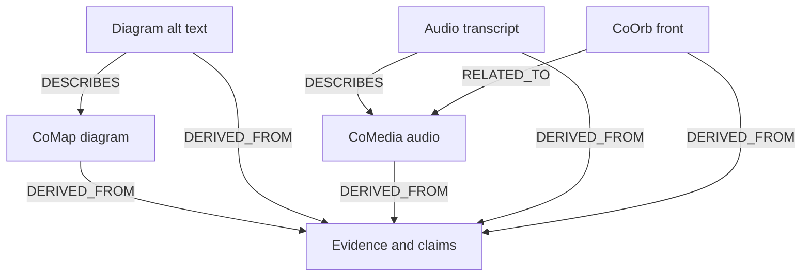

# Relational media view R0

**SOURCE-ONLY SYNTHETIC PROJECTION. NOT A SENT EMAIL OR LIVE WORKER.**

WorkID: `work:media-r0`
Source revision: `src-v1`
Public projection SHA-256: `2033fd4b5d4a3eb1289485bbb541d0068a92d14300c6721e2fd912819de1f892`

## Accessible text equivalent

- `work:media-r0` (SOURCE, PUBLIC): Evidence and claims; no outgoing relation
- `diagram:v1` (DIAGRAM, PUBLIC): CoMap diagram; DERIVED_FROM work:media-r0
- `alt:diagram` (ACCESSIBLE_TEXT, PUBLIC): Diagram alt text; DERIVED_FROM work:media-r0; DESCRIBES diagram:v1
- `audio:v1` (AUDIO, PUBLIC): CoMedia audio; DERIVED_FROM work:media-r0
- `alt:audio` (ACCESSIBLE_TEXT, PUBLIC): Audio transcript; DERIVED_FROM work:media-r0; DESCRIBES audio:v1
- `orb:v1` (ORB_VIEW, PUBLIC): CoOrb front; DERIVED_FROM work:media-r0; RELATED_TO audio:v1

## Evidence ceiling

- Public orphans: none in this fixture
- Stale public projections: none in this fixture
- Receiver ACK: NOT ESTABLISHED
- Media bytes or semantic parity: NOT TESTED
