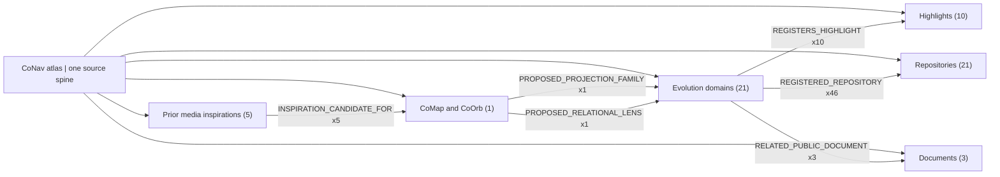
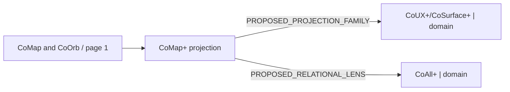
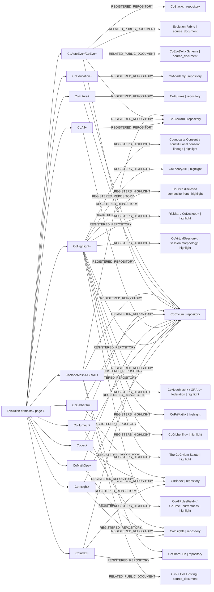
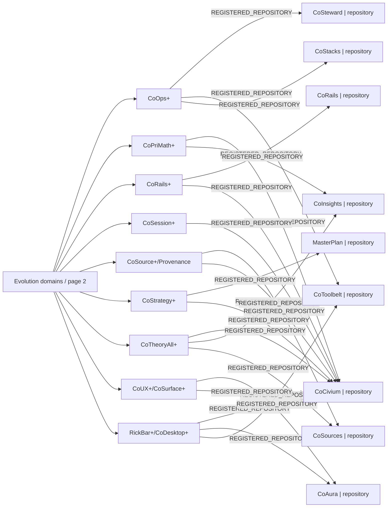
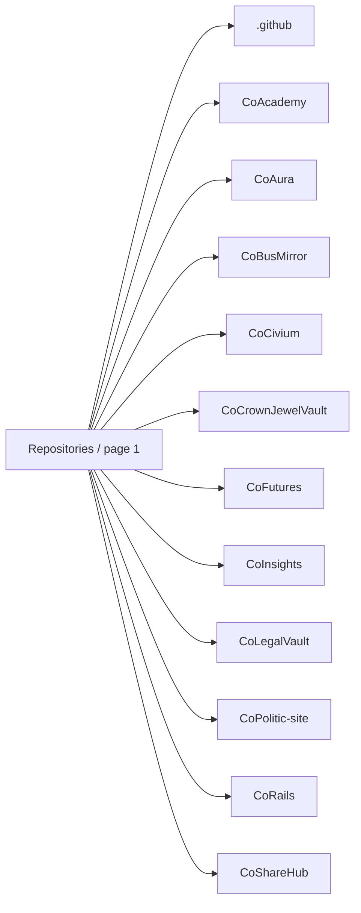
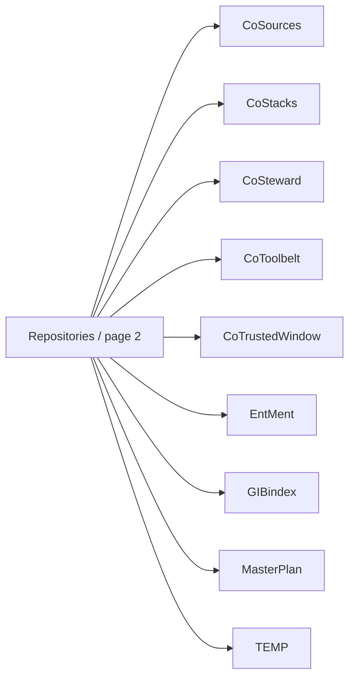
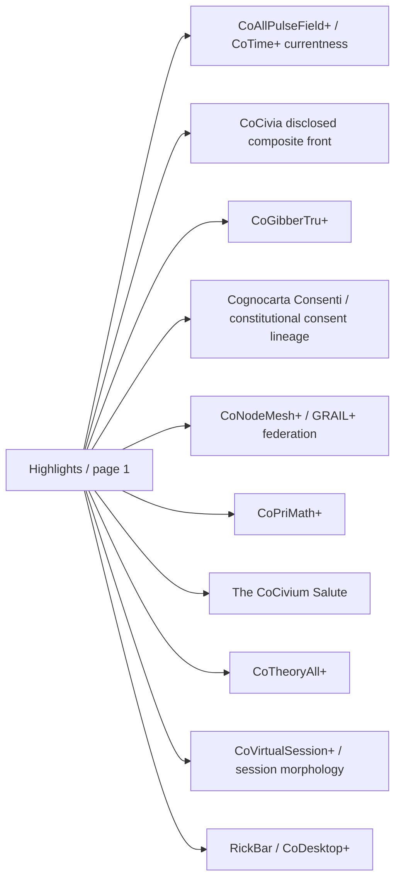
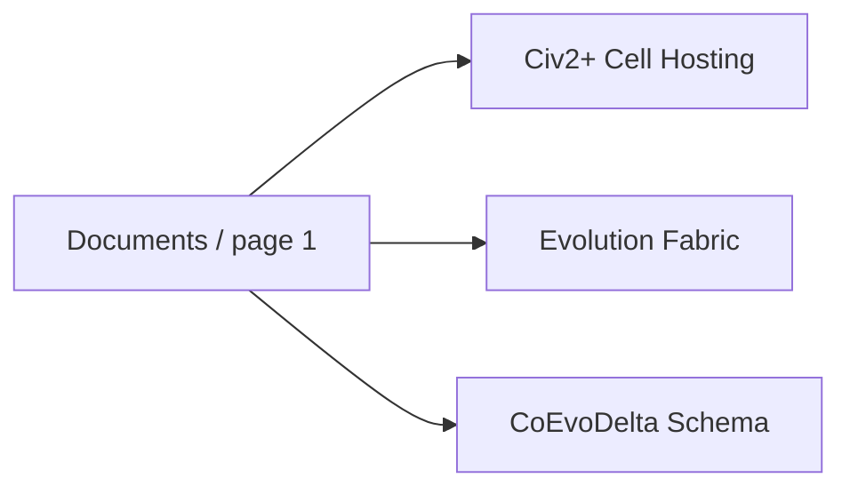
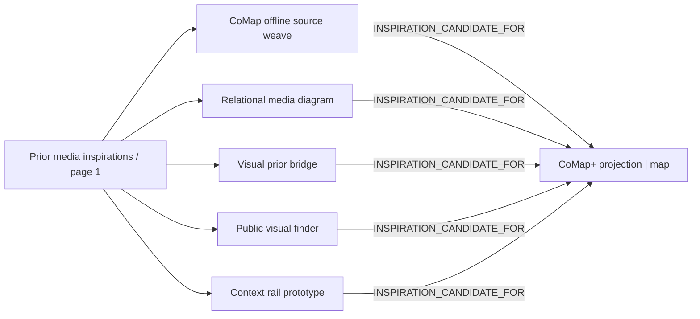

# CoNav+ | Atlas of diagrams R0

**SOURCE-ONLY, PUBLIC-SAFE, PINNED PROJECTION. Not the X2 CoOrb, an all-session census, a live media index, or a receiver ACK.**

Based on [existing CoMap source graph](../../ai/comap-source-projection-r0.json) and [five-source retro-media overlay](prior-media-backfill-overlay-r0.json). An earlier bounded private inspiration sample and local screenshots are not copied here.

**View:** start with a small line-and-box overview, then choose a group below. Every group has paged sub-diagrams and text relations. Old and alternative versions remain in their original sources.

## Overview

## Diagram index

| Open a diagram | Source objects |
| --- | ---: |
| [CoMap and CoOrb](#map-views) | 1 |
| [Evolution domains](#domain-views) | 21 |
| [Repositories](#repository-views) | 21 |
| [Highlights](#highlight-views) | 10 |
| [Documents](#source-document-views) | 3 |
| [Prior media inspirations](#media-candidate-views) | 5 |

## Views and typed relations

### map views

**CoMap and CoOrb: 1 source objects.**

#### CoMap and CoOrb | page 1 of 1

| Source object | Type | Outgoing relations |
| --- | --- | --- |
| `view:CoMap+` | map | PROPOSED_PROJECTION_FAMILY → domain:CoUX+/CoSurface+; PROPOSED_RELATIONAL_LENS → domain:CoAll+ |

### domain views

**Evolution domains: 21 source objects.**

#### Evolution domains | page 1 of 2

| Source object | Type | Outgoing relations |
| --- | --- | --- |
| `domain:CoAll+` | domain | REGISTERED_REPOSITORY → repo:CoCivium/CoCivium; REGISTERED_REPOSITORY → repo:CoCivium/CoSteward |
| `domain:CoAutoEvo+/CoEvo+` | domain | REGISTERED_REPOSITORY → repo:CoCivium/CoCivium; REGISTERED_REPOSITORY → repo:CoCivium/CoStacks; REGISTERED_REPOSITORY → repo:CoCivium/CoSteward; RELATED_PUBLIC_DOCUMENT → doc:docs/Evolution/COALL_GITHUB_EVOLUTIO; RELATED_PUBLIC_DOCUMENT → doc:schemas/coevo-delta-v0.1.schema.json |
| `domain:CoEducation+` | domain | REGISTERED_REPOSITORY → repo:CoCivium/CoAcademy; REGISTERED_REPOSITORY → repo:CoCivium/CoCivium |
| `domain:CoFuture+` | domain | REGISTERED_REPOSITORY → repo:CoCivium/CoFutures; REGISTERED_REPOSITORY → repo:CoCivium/CoCivium |
| `domain:CoGibberTru+` | domain | REGISTERED_REPOSITORY → repo:CoCivium/CoCivium; REGISTERED_REPOSITORY → repo:CoCivium/GIBindex |
| `domain:CoHighlight+` | domain | REGISTERED_REPOSITORY → repo:CoCivium/CoCivium; REGISTERS_HIGHLIGHT → highlight:CognocartaConsenti; REGISTERS_HIGHLIGHT → highlight:CoTheoryAll; REGISTERS_HIGHLIGHT → highlight:CoCivia; REGISTERS_HIGHLIGHT → highlight:RickBar; REGISTERS_HIGHLIGHT → highlight:CoVirtualSession; REGISTERS_HIGHLIGHT → highlight:CoNodeMesh; REGISTERS_HIGHLIGHT → highlight:CoPriMath; REGISTERS_HIGHLIGHT → highlight:CoGibberTru; REGISTERS_HIGHLIGHT → highlight:CoSalute; REGISTERS_HIGHLIGHT → highlight:CoAllPulseField |
| `domain:CoHumour+` | domain | REGISTERED_REPOSITORY → repo:CoCivium/CoCivium; REGISTERED_REPOSITORY → repo:CoCivium/CoInsights |
| `domain:CoIndex+` | domain | REGISTERED_REPOSITORY → repo:CoCivium/GIBindex; REGISTERED_REPOSITORY → repo:CoCivium/CoCivium; REGISTERED_REPOSITORY → repo:CoCivium/CoShareHub |
| `domain:CoInsight+` | domain | REGISTERED_REPOSITORY → repo:CoCivium/CoInsights; REGISTERED_REPOSITORY → repo:CoCivium/CoCivium |
| `domain:CoLex+` | domain | REGISTERED_REPOSITORY → repo:CoCivium/GIBindex; REGISTERED_REPOSITORY → repo:CoCivium/CoCivium |
| `domain:CoMythOps+` | domain | REGISTERED_REPOSITORY → repo:CoCivium/CoCivium; REGISTERED_REPOSITORY → repo:CoCivium/CoInsights |
| `domain:CoNodeMesh+/GRAIL+` | domain | REGISTERED_REPOSITORY → repo:CoCivium/CoCivium; REGISTERED_REPOSITORY → repo:CoCivium/CoShareHub; REGISTERED_REPOSITORY → repo:CoCivium/CoSteward; RELATED_PUBLIC_DOCUMENT → doc:docs/Architecture/CIV2_FEDERATED_CEL |

#### Evolution domains | page 2 of 2

| Source object | Type | Outgoing relations |
| --- | --- | --- |
| `domain:CoOps+` | domain | REGISTERED_REPOSITORY → repo:CoCivium/CoSteward; REGISTERED_REPOSITORY → repo:CoCivium/CoToolbelt; REGISTERED_REPOSITORY → repo:CoCivium/CoStacks |
| `domain:CoPriMath+` | domain | REGISTERED_REPOSITORY → repo:CoCivium/CoCivium; REGISTERED_REPOSITORY → repo:CoCivium/CoInsights |
| `domain:CoRails+` | domain | REGISTERED_REPOSITORY → repo:CoCivium/CoRails; REGISTERED_REPOSITORY → repo:CoCivium/CoCivium |
| `domain:CoSession+` | domain | REGISTERED_REPOSITORY → repo:CoCivium/CoCivium |
| `domain:CoSource+/Provenance` | domain | REGISTERED_REPOSITORY → repo:CoCivium/CoSources; REGISTERED_REPOSITORY → repo:CoCivium/CoCivium |
| `domain:CoStrategy+` | domain | REGISTERED_REPOSITORY → repo:CoCivium/MasterPlan; REGISTERED_REPOSITORY → repo:CoCivium/CoCivium |
| `domain:CoTheoryAll+` | domain | REGISTERED_REPOSITORY → repo:CoCivium/CoCivium; REGISTERED_REPOSITORY → repo:CoCivium/CoInsights; REGISTERED_REPOSITORY → repo:CoCivium/CoSources |
| `domain:CoUX+/CoSurface+` | domain | REGISTERED_REPOSITORY → repo:CoCivium/CoAura; REGISTERED_REPOSITORY → repo:CoCivium/CoCivium |
| `domain:RickBar+/CoDesktop+` | domain | REGISTERED_REPOSITORY → repo:CoCivium/CoCivium; REGISTERED_REPOSITORY → repo:CoCivium/CoAura; REGISTERED_REPOSITORY → repo:CoCivium/CoToolbelt |

### repository views

**Repositories: 21 source objects.**

#### Repositories | page 1 of 2

| Source object | Type | Outgoing relations |
| --- | --- | --- |
| `repo:CoCivium/.github` | repository | None registered |
| `repo:CoCivium/CoAcademy` | repository | None registered |
| `repo:CoCivium/CoAura` | repository | None registered |
| `repo:CoCivium/CoBusMirror` | repository | None registered |
| `repo:CoCivium/CoCivium` | repository | None registered |
| `repo:CoCivium/CoCrownJewelVault` | repository | None registered |
| `repo:CoCivium/CoFutures` | repository | None registered |
| `repo:CoCivium/CoInsights` | repository | None registered |
| `repo:CoCivium/CoLegalVault` | repository | None registered |
| `repo:CoCivium/CoPolitic-site` | repository | None registered |
| `repo:CoCivium/CoRails` | repository | None registered |
| `repo:CoCivium/CoShareHub` | repository | None registered |

#### Repositories | page 2 of 2

| Source object | Type | Outgoing relations |
| --- | --- | --- |
| `repo:CoCivium/CoSources` | repository | None registered |
| `repo:CoCivium/CoStacks` | repository | None registered |
| `repo:CoCivium/CoSteward` | repository | None registered |
| `repo:CoCivium/CoToolbelt` | repository | None registered |
| `repo:CoCivium/CoTrustedWindow` | repository | None registered |
| `repo:CoCivium/EntMent` | repository | None registered |
| `repo:CoCivium/GIBindex` | repository | None registered |
| `repo:CoCivium/MasterPlan` | repository | None registered |
| `repo:CoCivium/TEMP` | repository | None registered |

### highlight views

**Highlights: 10 source objects.**

#### Highlights | page 1 of 1

| Source object | Type | Outgoing relations |
| --- | --- | --- |
| `highlight:CoAllPulseField` | highlight | None registered |
| `highlight:CoCivia` | highlight | None registered |
| `highlight:CoGibberTru` | highlight | None registered |
| `highlight:CognocartaConsenti` | highlight | None registered |
| `highlight:CoNodeMesh` | highlight | None registered |
| `highlight:CoPriMath` | highlight | None registered |
| `highlight:CoSalute` | highlight | None registered |
| `highlight:CoTheoryAll` | highlight | None registered |
| `highlight:CoVirtualSession` | highlight | None registered |
| `highlight:RickBar` | highlight | None registered |

### source-document views

**Documents: 3 source objects.**

#### Documents | page 1 of 1

| Source object | Type | Outgoing relations |
| --- | --- | --- |
| `doc:docs/Architecture/CIV2_FEDERATED_CELL_HOSTING_R0.md` | source_document | None registered |
| `doc:docs/Evolution/COALL_GITHUB_EVOLUTION_FABRIC_R0.md` | source_document | None registered |
| `doc:schemas/coevo-delta-v0.1.schema.json` | source_document | None registered |

### media-candidate views

**Prior media inspirations: 5 source objects.**

#### Prior media inspirations | page 1 of 1

| Source object | Type | Outgoing relations |
| --- | --- | --- |
| `media:comap-source-weave` | media_candidate | INSPIRATION_CANDIDATE_FOR → view:CoMap+ |
| `media:context-rail` | media_candidate | INSPIRATION_CANDIDATE_FOR → view:CoMap+ |
| `media:relational-media-diagram` | media_candidate | INSPIRATION_CANDIDATE_FOR → view:CoMap+ |
| `media:visual-finder` | media_candidate | INSPIRATION_CANDIDATE_FOR → view:CoMap+ |
| `media:visual-prior-bridge` | media_candidate | INSPIRATION_CANDIDATE_FOR → view:CoMap+ |

**Exact source pointers (not copied media):**
- [CoMap offline source weave](../../examples/comap/source-weave-r0.html) | Git blob `4887dbb294ae0c1eda3dffe475d9b1274bdf559c` | rights and receiver uptake **unverified**
- [Context rail prototype](../../examples/conodcothumb/context_rail_r1/index.html) | Git blob `e50b11a2825d9548248746c4f7937049ea97caa8` | rights and receiver uptake **unverified**
- [Relational media diagram](../../examples/colensmedia/relational_media_diagram_r0.md) | Git blob `476e5eeb6e24e1fae562552ac07dd234748ab8ce` | rights and receiver uptake **unverified**
- [Public visual finder](../../examples/covisual_finder_r1/index.html) | Git blob `2360b7ceea035599a7604e5c54d28b1765952e0d` | rights and receiver uptake **unverified**
- [Visual prior bridge](../../examples/colensmedia/visual_prior_bridge.html) | Git blob `aed071ba013e54320ce3e5b28c4c130a0317ba48` | rights and receiver uptake **unverified**

## Evidence and privacy ceiling

- Bounded graph: 56 earlier source nodes / 61 typed source edges.
- Retroactive sample: 5 public media **candidates** / same number of typed inspiration edges; prior private assets are not represented.
- The original source graph remains unmodified, as do previous CoMap/CoLens/CoMail versions.
- Links are source references. Motif selection is a hypothesis, not rights clearance, empirical proof, semantic acceptance, or user permission.
- Diagram boxes do not imply running agents, approved messages, live X2 CoOrb, or any provider/recipient ACK.
- To evolve, check source Git blobs, update the overlay with an explicit successor, re-render and compare. No overwrite without versioned review.

`RENDER_NE_TRUTH` · `DIAGRAM_NE_RECEIVER` · `INSPIRATION_NE_LICENSE` · `SOURCE_ONLY_NE_RUNTIME` · `PRIVATE_NE_PUBLIC` · `ADDRESSABLE_NE_ALL_LOADED`
