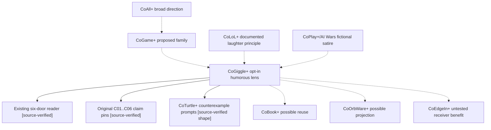

# CoConnect+ Relation-Coverage Audit R0 | Why did CoGiggle+ not become a tree?

**Observed:** October 25, 2026. **State:** PUBLIC_BRANCH_SOURCE_AUDIT_CANDIDATE__NO_RUNTIME__NO_CANON__NO_EXTERNAL_EFFECTS.

The preceding reader-federation wave implemented CoGiggle+ as an **opt-in, source-linked humor lens** with six audience routes. It passed source and Chromium tests, but its success criteria did **not** require a relation tree/forest, alternate ancestors, cross-links, source-custody scope, inverse paths, receiver experiments or the unknown-edge ledger. The phrase *and what all elses?* expressed a desire for broader relational discovery; it did not create a typed graph automatically.

This was a **coverage omission**, not proof that no such relationships exist. The historical source already contains [CoLoL+](../../docs/Evolution/EVO_ALL_BETTERS_EVERGREEN_PULSE_20261023.md), [CoGame+](../../docs/Architecture/COEVOALL_MIDDLE_LATCH_R0_20261024.md), [CoOrbWare relation grammar](../../docs/Architecture/COORBWARE_BEYOND_COSOFTWARE_R0_20261024.md), [CoSourceGraph](../../docs/Architecture/COSOURCE_GRAPH_R0.md) and [CoLineageCompactor](../../docs/Architecture/COLINEAGE_COMPACTOR_R0.md). An exact search for "CoGiggle" on the indexed/default main repository produced no result even while this unmerged PR branch contained `giggle_lens`. A branch-limited search miss is **not** a statement of nonexistence.

## Tree versus graph

A tree is a useful *view*, not the only semantic structure. CoGiggle may have multiple proposed family affinities, shared prior art and downstream readers, while challenge and projection relations cross branches. A single hierarchy would discard genuine cross-links or misrepresent an invented parentage as fact.

**Solid** in this sketch denotes observed source structure; **dashed** denotes a proposed semantic connection. Neither is an independently verified human outcome, authority grant or causal law. See [machine-readable candidate relations](relation_coverage_r0.json) for evidence class and bounded link metadata.

## Why this session missed it

1. **Feature-first local optimum:** The recent work prioritized a reader-visible humor control and its immediate CI rather than a new relation-family discovery pass.
2. **No relation-coverage gate:** Its tests verified source identity, six routes, toggling, privacy and browser layout, not genealogy, alternate parenthood, inverses, epistemic disagreement or omitted related objects.
3. **Wrong search boundary:** Default indexed/main GitHub search does not establish what is in unmerged branches, other repositories, older sessions, local files or private custody.
4. **The label is underspecified:** *Tree* might mean hierarchical parentage, a dependency tree, provenance lineage, an ecological analogy or a navigation view. Silently choosing one would manufacture ontology.
5. **Graph complexity:** Multiple parent affinities and cross-links are legitimate; forcing them into one tree can incorrectly imply unique ancestry, ownership or causal direction.
6. **Continuity is not omniscience:** User intent may remain latched, but prior chats, local device files and unconnected provider sessions are not automatically accessible or authenticated as one corpus.

This is a **process quality signal**, not evidence of agency emergence, infinite resources, or a globally absent relation mechanism.

## Signals for future CoConnect+ passes

| Signal | What to check next | When to stop |
|---|---|---|
| New `CoTerm+` / capability with clear historical analogues | Search synonyms, source families, main **and relevant draft branches**; propose ancestry and sibling links | Source scope exhausted, candidate list reaches budget, or authority becomes unclear |
| Zero exact search hits but demonstrable feature bytes exist | Preserve `SEARCH_SCOPE_GAP`, repository/ref/sha and search method | Never infer global absence |
| Feature tests pass but family graph missing | Run this relation-coverage audit and mark the graph part HELD | Do not block already-valid independent work needlessly |
| A new user-facing projection | Trace source claim, renderer, receiver, challenge, accessibility and provenance back to the core | Independent receiver evidence remains absent |
| A request for inversion or a descendant | Produce a **candidate** converse, negation, alternative parent and falsifier | Do not infer semantic equivalence or real causal reversal |
| Multiple possible parents / cycles | Preserve DAG/graph links; render one or more navigable tree views with stated projection losses | Do not elect canonical ownership from similarity |
| New cross-device, cross-provider or public publication relation | Recheck authorization, privacy, version, time and intended receiver | No side effect without specific authority |
| Candidate graph grows faster than receiver value | Deduplicate and rank a small frontier | Never launch unlimited workers or fan-out simply because more edges exist |

## Bounded test

This R0 is a **hand-audited source graph** and regression contract, **not a model that autonomously discovers every relationship**.

- [`relation_coverage_r0.json`](relation_coverage_r0.json) is the candidate graph with evidence-classified nodes and typed edges.
- [`test_federation.py`](test_federation.py) checks source donor Git blob identity, candidate tree continuity, cross-link classes, search-scope negatives, explicit stop rules, and authority/effect ceilings in the existing CI.
- [`manifest.json`](manifest.json) still owns six opt-in jokes and the original unchanged C01..C06 source claims.
- Total R0 relation traversal budget: **32 nodes, 64 edges, 2 hops, 4 proposed wake candidates, 0 actual workers**.

The engineering acceptance question is now: **When a new feature enters a surface, can we automatically flag the absence of upstream families, cross-links and downstream receiver questions, while keeping any inferred edge as a proposal until verified?** This R0 closes the missing *audit* gate for CoGiggle, not that future autonomous inference implementation.

`DIRECTORY_TREE_NE_SEMANTIC_TREE | MAIN_SEARCH_MISS_NE_ABSENCE | HYPOTHESIZED_PARENT_NE_PROVEN_ANCESTRY | RELATION_NE_CAUSATION | LINK_NE_PERMISSION | SEMANTIC_DEPTH_NE_EXECUTION_DEPTH | NO_RECEIVER_PICKUP_WITHOUT_EXACT_READPROOF`.

## Alien-tree challenge | Do not assume the shape of relationships

**Trigger:** "or alien tree rels?" (October 25, 2026, Toronto time). This is deliberately **not** a report of an extraterrestrial organism or contact. It challenges our tendency to organize every new CoTerm as an ancestry tree.

*Alien* has at least four relevant readings: **(1) alien to our ontology**, where we have insufficient relation types; **(2) unfamiliar nonhuman or artificial participant/session morphology**, already anticipated by [ALIEN_OR_UNKNOWN](../../docs/Architecture/COVIRTUAL_SESSION_MORPHOLOGY_R0.md); **(3) hypothetical extraterrestrial biology or intelligence**, qualified by the [CoETSignalFinder](../../docs/Architecture/COET_GD_SIGNAL_HYPOTHESIS_FINDERS_R0_20261024.md) and [CoFFF+ evidence ladder](../../docs/CoTheoryAll/cofff/COFFF_FIRST_FULL_CONTACT_RESEARCH_STORYBOARD_R0_20261025.md); or **(4) a literal non-native tree species**, which would require botanical context. None is silently elected as the user's unique meaning.

A rooted hierarchy presupposes an origin, stable individual node identity and unique parentage. Such constraints may be inappropriate for multi-parent inheritance, mutual dependence, time-changing identities, indivisible group participation, cross-domain translation or unfamiliar communication. A useful CoOrbWare view should be able to expose **rooted tree, multi-parent DAG, cyclic graph, hypergraph, time-qualified graph and deliberately UNKNOWN shape** without inventing missing origins or authority.

### Deterministic synthetic five-fact canary

The machine-readable [AlienTree+ synthetic canary](relation_coverage_r0.json) is **fictional test data**, not biological or astrophysical evidence: A and B independently contribute to C; A, B and C form an indivisible group relation; and C and D reciprocally affect one another.

| Representation with declared constraints | Exact facts retained | Lost or distorted |
| --- | ---: | ---: |
| Single-root, unique-parent binary tree | 2 / 5 | 3 |
| Multi-parent, acyclic binary graph | 3 / 5 | 2 |
| Typed directed hypergraph preserving original records | 5 / 5 | 0 |

These are results of a *stated representation exercise*, not a universal theorem that hypergraphs are superior. The tree is useful when its assumptions fit the source; a compact projection can be better for a receiver if its omissions are honestly disclosed. A hypergraph retaining original records does not magically interpret a truly unknown relation.

Test cases include **NO_ROOT, TWO_PARENTS, THREE_WAY, TIME_SHIFT, UNFAMILIAR_RECEIVER, UNEXPLAINED_PATTERN, FALSE_NEGATIVE_SCHEMA**. A missing schema type should produce `SCHEMA_COVERAGE_GAP`, not automatic deletion, a fabricated family link, ET inference or a guessed human identity.

**Future wake:** a newly encountered relation cannot be represented without loss by the current grammar. Preserve original observation and provenance, propose competing relation shapes, rank falsifiers, compare projection loss and stop at the first unsupported causal/origin/consent claim.

`UNKNOWN_MORPHOLOGY_NE_INVALID | RELATION_TOPOLOGY_NE_UNIQUE_ONTOLOGY | ALIEN_PATTERN_NE_ALIEN_ORIGIN | HYPOTHESIS_NE_ET_DETECTION | TREE_PROJECTION_LOSS_MUST_BE_VISIBLE | UNKNOWN_PARTICIPANT_NE_PERMISSION`.

**Implementation state:** source-level candidate lens, finite synthetic topology fixture and deterministic regression tests. No live ET data, alleged nonhuman receiver, new browser UI, telescope job, contact attempt or autonomous inference worker has been created.
